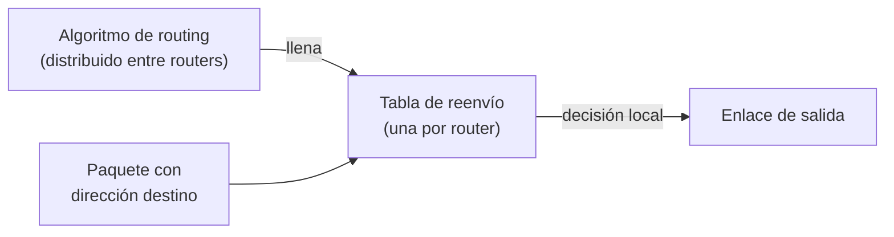

# Servicios de la capa de red: enrutamiento y reenvío

La capa de transporte comunica procesos, pero supone que el segmento llega de algún modo al host correcto. De eso se encarga la **capa de red**: transmitir **paquetes** (o **datagramas**, su unidad de transmisión) desde el emisor hasta el receptor, dirigiendo cada mensaje para que encuentre al servidor aunque haya muchos dispositivos de por medio.

## La capa de red vive en cada salto

A diferencia de la capa de transporte, que solo existe en los extremos, la capa de red **ocurre en cada dispositivo intermedio**. Los routers implementan la pila hasta la capa *Network*: miran la dirección de destino del paquete y deciden a dónde mandarlo. El paquete va saltando de router en router hasta llegar.


> [!example]- Transcripción de la imagen
> El *End system H1* (en una *Home Network*) y el *End system H2* (en una *Enterprise Network*) tienen la pila completa: *Application, Transport, Network, Data link, Physical*. Entre ellos hay routers (*Router R1*, los del *Local or Regional ISP*, *Router R2*), y cada uno muestra solo tres capas: *Network, Data link, Physical*. La capa *Network* aparece destacada en todos los dispositivos.

## Dos desafíos: direccionamiento y enrutamiento

| Desafío | Pregunta que responde | Qué exige |
|---|---|---|
| **Direccionamiento** | ¿Dónde está el nodo destino en la red? | Cada host tiene una **dirección única**, y el paquete lleva información suficiente para encontrar al destino |
| **Enrutamiento** | ¿Cómo se coordinan los routers para que el paquete llegue? | **Algoritmos de enrutamiento** (*routing*) que calculen rutas de forma eficiente |

El direccionamiento se desarrolla en [[03 - Direccionamiento IPv4: subredes, máscaras y notación CIDR|direccionamiento IPv4]] y los algoritmos en [[16-Algoritmos de ruteo/01 - Modelos de grafo y algoritmos Link-State (Dijkstra)|algoritmos de ruteo]].

## Store-and-forward: reenvío y enrutamiento

Los routers son dispositivos de **almacenamiento y reenvío** (*store-and-forward*): guardan el paquete, lo examinan y lo reenvían. Para eso separan dos tareas:

- **Reenvío (*forwarding*)**, el **plano de datos**: una **decisión local** de cada router. Mira la dirección de destino en el header y, con su **tabla de reenvío** (*forwarding table*), decide por qué salida mandar el paquete. Cada router tiene su propia tabla.
- **Enrutamiento (*routing*)**, el **plano de control**: una **decisión distribuida** entre routers. Todos ejecutan un algoritmo de routing (en Internet, protocolos como OSPF dentro de una red y BGP entre redes, ver [[16-Algoritmos de ruteo/03 - Enrutamiento jerárquico y sistemas autónomos (Intra-AS e Inter-AS)|enrutamiento jerárquico]]), y ese algoritmo es el que **llena las tablas de reenvío**.



Un router debe tener respuesta para **cualquier** dirección posible. Como no puede guardar una fila por dirección, la tabla contiene **prefijos** (rangos de direcciones), y si varios calzan se usa el más específico:

```python
from ipaddress import ip_address, ip_network

# Tabla de reenvío de UN router: prefijo de destino -> enlace de salida
tabla = {
    ip_network("200.23.16.0/21"): "enlace 0",
    ip_network("200.23.24.0/24"): "enlace 1",
    ip_network("200.23.24.0/21"): "enlace 2",
    ip_network("0.0.0.0/0"):      "enlace 3",   # todo lo demás
}

def reenviar(destino):
    """Decisión local: el prefijo más específico que contiene al destino."""
    d = ip_address(destino)
    candidatos = [red for red in tabla if d in red]
    return tabla[max(candidatos, key=lambda red: red.prefixlen)]

for dst in ["200.23.22.161", "200.23.24.170", "200.23.25.5", "8.8.8.8"]:
    print(dst, "->", reenviar(dst))   # enlace 0, 1, 2 y 3
```

Como el router recibe el paquete **completo** antes de reenviarlo, cada salto agrega un retardo de transmisión: con $N$ enlaces iguales de tasa $R$ y un paquete de $L$ bits, el retardo extremo a extremo es $N \cdot \frac{L}{R}$ (ver [[12-Fundamentos de redes y modelos en capas/03 - Conmutación de paquetes frente a conmutación de circuitos|conmutación de paquetes]]).

## Modos de conexión

| | Red de circuitos virtuales | Red de datagramas |
|---|---|---|
| Esquema | Red telefónica | Internet |
| Funcionamiento | *Setup* del circuito (reserva ancho de banda), transferencia de datos y destrucción del circuito | Cada paquete lleva la dirección de destino y los routers reenvían según su tabla |
| Estado en el router | Lo mantiene: *connection-oriented* | Ninguno; no conocen caminos: *connectionless* |
| Ancho de banda | Garantizado durante la conexión | No garantizado, pero flexible ante congestión y mejor aprovechado |

En una red de datagramas, dos paquetes de la misma comunicación **pueden tomar caminos distintos**. Internet ofrece así un servicio de **mejor esfuerzo**: no garantiza entrega, orden ni ancho de banda, y la confiabilidad queda en manos de [[14-Capa de transporte/06 - Protocolo TCP: estructura del segmento, MSS y confirmación acumulativa|TCP]] en los extremos.

Video de apoyo: [Capa de red](https://www.youtube.com/watch?v=syQOSjc-7NY&list=PLVTkEjeczcER2aOMHPIfaHCpTx61iKsoV&index=65).

## Preguntas de repaso

> [!question]- ¿Cuáles son los dos desafíos que resuelve la capa de red?
> El direccionamiento (ubicar al nodo destino: cada host con una dirección única) y el enrutamiento (coordinar a los routers para que el paquete llegue).

> [!question]- ¿Qué diferencia hay entre *forwarding* y *routing*?
> El forwarding es la decisión local de un router sobre por qué salida enviar un paquete, usando su tabla de reenvío. El routing es la decisión distribuida entre routers, cuyo algoritmo llena esas tablas.

> [!question]- ¿Por qué la tabla de reenvío guarda prefijos y no direcciones individuales?
> Porque el router debe tener respuesta para cualquier dirección posible, y una fila por dirección sería inmanejable. Con prefijos, un rango completo comparte la misma salida.

> [!question]- ¿Qué diferencia una red de circuitos virtuales de una de datagramas?
> En la primera se establece un circuito, los routers guardan estado y el ancho de banda está garantizado. En la de datagramas cada paquete lleva su destino, los routers no guardan estado y no hay garantías, pero se aprovecha mejor el ancho de banda.
