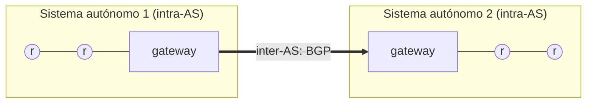
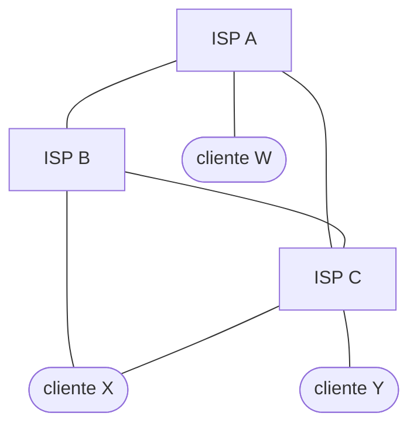

# Enrutamiento jerárquico y sistemas autónomos (Intra-AS e Inter-AS)

[[01 - Modelos de grafo y algoritmos Link-State (Dijkstra)|Link-State]] y [[02 - Algoritmos Distance-Vector (Bellman-Ford) y conteo al infinito|Distance-Vector]] suponen un solo grafo de routers. Internet es demasiado grande para eso, y además sus routers no tienen un solo dueño. La solución es dividir el problema en dos niveles.

## Por qué hace falta una jerarquía

- **No es factible almacenar tablas para todos los routers de Internet.**
- Los routers **pertenecen a distintas organizaciones**, y cada una quiere decidir cómo funciona su red.

Por eso las redes se organizan **jerárquicamente**: los routers que pertenecen al mismo dominio administrativo forman un **sistema autónomo (AS)**. Desde lejos, Internet deja de verse como un conjunto de routers y pasa a verse como un **conjunto de sistemas autónomos interconectados**.

- Los algoritmos **intra-AS** resuelven el ruteo **dentro** de un AS, en un subconjunto de la red.
- Los algoritmos **inter-AS** ayudan a determinar las **tablas de reenvío entre distintos AS**.
- Los routers de salida de un AS, que lo conectan con otros, son los **gateway routers**.

## Intra-AS: IGP

Los protocolos intra-AS se llaman **IGP** (*Interior Gateway Protocols*). Como cada AS está administrado por **una sola entidad**, conseguir la topología interna es fácil, y se puede usar Link-State:

| Protocolo | Algoritmo | Dónde se usa |
|---|---|---|
| **RIP** (*Routing Information Protocol*) | Distance-Vector | ISP de nivel bajo (*lower tier*) |
| **OSPF** (*Open Shortest-Path First*) | Link-State | ISP de nivel alto (*upper tier*) |

## Inter-AS: BGP

**BGP** (*Border Gateway Protocol*, RFC 4271) es el **estándar de facto para la comunicación inter-AS** (a los protocolos entre AS se les llama EGP, *Exterior Gateway Protocols*). Cada anuncio lleva la lista de AS que recorre el camino (AS-PATH), como los caminos (A, W) o (B, A, W) del ejemplo de abajo. BGP permite:

- que una subred **anuncie su existencia** a Internet;
- obtener información de **alcanzabilidad** (*reachability*) de otras subredes;
- **propagar** esa información a los nodos internos del AS;
- determinar **buenas rutas** hacia otras subredes, según alcanzabilidad o **políticas** específicas.

Lo último es lo distintivo: entre AS no manda solo el costo, sino también los **acuerdos comerciales**. Ejemplo con los ISP A, B y C y los clientes W, X e Y:

- A le anuncia a B el camino (A, W).
- B le anuncia a su cliente X el camino (B, A, W).
- ¿Debería B anunciarle a C el camino (B, A, W)? **No**: B no obtiene ningún beneficio por enrutar tráfico (C, B, A, W), porque ni C ni W son sus clientes. B quiere enrutar **solo hacia y desde sus clientes**, y prefiere forzar a que C llegue a W a través de A.

Cuando un AS tiene varios gateway routers que llevan a un mismo destino externo, una técnica habitual es la **papa caliente** (*hot-potato routing*): elegir el gateway con menor costo **intra-AS**, para sacar el paquete de la propia red lo antes posible.

## Preguntas de repaso

> [!question]- ¿Por qué Internet usa enrutamiento jerárquico en vez de un solo algoritmo sobre todos los routers?
> Porque no es factible que cada router guarde tablas para todo Internet, y porque los routers pertenecen a organizaciones distintas que quieren administrar su propia red.

> [!question]- ¿Qué es un sistema autónomo y qué es un gateway router?
> Un AS es el conjunto de routers bajo un mismo dominio administrativo. Un gateway router es un router de salida del AS, que lo conecta con otros AS.

> [!question]- ¿Qué algoritmo usan RIP y OSPF?
> RIP usa Distance-Vector (ISP de nivel bajo) y OSPF usa Link-State (ISP de nivel alto). Ambos son intra-AS.

> [!question]- En el ejemplo, ¿por qué B no le anuncia a C el camino (B, A, W)?
> Porque B no gana nada transportando tráfico entre C y W, que no son sus clientes. Con BGP, B aplica la política de enrutar solo el tráfico de sus clientes.
