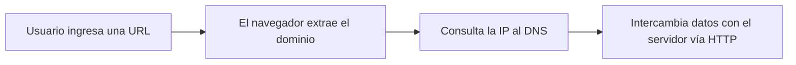

# Direcciones IP y DNS

Hasta aquí se sabe que los computadores se conectan por Internet y que una máquina puede tener un nombre como `uc.cl`. Pero los routers no entienden nombres: para entregar un mensaje necesitan un número que identifique a cada máquina. Esta nota responde dos preguntas: cómo se identifica cada computador y cómo el navegador obtiene ese número a partir del nombre que escribió el usuario.

## Direcciones IP

Una **dirección IP** es una etiqueta numérica asociada a un dispositivo de una red que usa el protocolo de internet (IP) para comunicarse. Con ella el servidor también sabe **quién le está hablando**, porque cada mensaje lleva la IP de origen. Hay dos versiones:

| Versión | Tamaño | Ejemplo | Comentario |
|---|---|---|---|
| **IPv4** | 32 bits | `192.0.2.1` | La más conocida |
| **IPv6** | 128 bits | `2001:db8:0:1234:0:567:8:1` | Propuesta porque las direcciones IPv4 no alcanzan para el crecimiento de Internet |

La IANA administra la asignación de direcciones IP a nivel mundial.

> [!tip] IP estática frente a dinámica
> Una IP **estática** se asigna a un dispositivo y no cambia (típico de servidores). La mayoría de los dispositivos usa IP **dinámicas**: la red se las asigna al conectarse y cambian con el tiempo.

## DNS: el traductor de nombres

El usuario solo conoce el nombre, no la IP. El **DNS** (*Domain Name System*) hace la traducción: funciona como un **diccionario** cuya llave es el dominio y cuyo valor es la IP. No es un único servidor, sino un sistema **distribuido y jerárquico** de servidores que guardan esos mapeos.

> [!example]- Transcripción de la imagen
> 1. El navegador pregunta al servidor DNS por `www.example.com`.
> 2. El servidor DNS responde con la IP `12.45.56.67`.
> 3. El navegador envía la request HTTP a `12.45.56.67`, el servidor web.
> 4. El servidor web responde con el documento solicitado.

## Resolvers públicos

La primera parada de un nombre es un **DNS resolver**. Si no tiene la respuesta en su caché, pregunta a un servidor raíz (*root*), luego al servidor del TLD y así hasta llegar al servidor autoritativo del dominio. Las direcciones `1.1.1.1` (operada por Cloudflare) y `8.8.8.8` (operada por Google) son resolvers públicos que se pueden configurar en lugar del que entrega el ISP.

El detalle de la jerarquía, las consultas iterativas y recursivas y los tipos de registro está en [[05 - Sistema de nombres de dominio (DNS) y resolución de consultas|DNS y resolución de consultas]].

## El recorrido hasta aquí

El último paso es el tema de [[04 - Mensajes HTTP y versiones del protocolo|Mensajes HTTP y versiones del protocolo]].

> [!warning] El DNS no transporta la página
> El DNS solo entrega la IP. La página llega en una conexión aparte, directa con el servidor web. Si el DNS falla, el sitio parece caído aunque el servidor esté funcionando perfectamente.

## Preguntas de repaso

> [!question]- ¿Por qué se necesita el DNS si cada máquina ya tiene una IP?
> Porque las personas recuerdan nombres, no números, y porque la IP de un servicio puede cambiar sin que cambie su nombre. El DNS desacopla ambos: el usuario usa el dominio y el sistema lo traduce a la IP vigente.

> [!question]- ¿Qué motivó la creación de IPv6?
> IPv4 usa 32 bits, lo que da unos 4300 millones de direcciones, insuficientes para el crecimiento de Internet. IPv6 usa 128 bits y amplía enormemente el espacio de direcciones.

> [!question]- ¿Qué hace un resolver como `8.8.8.8` cuando no tiene un nombre en caché?
> Recorre la jerarquía: pregunta al servidor raíz, luego al del TLD y luego al autoritativo del dominio, hasta obtener la IP. Después la guarda en caché para responder más rápido la próxima vez.
