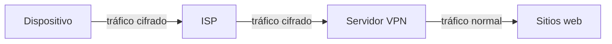

# Navegación privada, VPN y proxy

Con el recorrido de una request claro (navegador, router, ISP, DNS, servidor), se puede responder una pregunta práctica: **quién ve qué** cuando se navega. El modo incógnito, las VPN y los proxies prometen privacidad, pero cada uno protege frente a un actor distinto. Confundirlos lleva a creer que se está más protegido de lo que realmente se está.

## Modo incógnito: privacidad local

El modo incógnito solo actúa sobre **el propio computador**:

| Qué hace | Qué no hace |
|---|---|
| No guarda el historial de navegación | No oculta la actividad del ISP, que igual enruta el tráfico y ve qué sitios se visitan |
| No guarda cookies; por eso hay que volver a iniciar sesión aunque haya una sesión abierta en otra ventana | No oculta la IP ni la ubicación |
| No guarda datos de formularios ni contraseñas | No da anonimato: administradores de red, anuncios y sitios pueden rastrear la actividad |
| No guarda caché | No protege contra malware |

> [!tip] Incógnito protege frente a quien usa el mismo computador
> Sirve para no dejar rastro en el dispositivo (por ejemplo, en un computador compartido), no para esconderse de la red.

## VPN: cifrar todo el tráfico

Una **VPN** cifra todas las conexiones del dispositivo hasta un **servidor VPN**. Los datos pasan cifrados por el ISP y se descifran en el servidor VPN, que hace las conexiones a Internet en nombre del usuario. Así, el ISP ya no ve los sitios visitados ni el contenido; ahora quien sí puede verlos es el servidor VPN.

La VPN tiene costos:

- Se traslada la confianza: si la encriptación se rompe (por ejemplo, con una puerta trasera) o se filtran los logs del servidor VPN, la privacidad buscada desaparece.
- Agrega un intermediario más, así que las conexiones se vuelven más lentas.

## Proxy frente a VPN

Ambos son un **servidor intermedio** que hace la request a Internet en lugar del cliente, y así ocultan el origen real de la conexión. Se diferencian en dos aspectos:

| | **Proxy** | **VPN** |
|---|---|---|
| Alcance | Una aplicación (por ejemplo, solo el navegador) | Todo el tráfico de red del dispositivo |
| Cifrado | No cifra | Cifra hasta el servidor VPN |

## Redes públicas

Una red Wi-Fi pública se considera tradicionalmente insegura porque expone a ataques **man in the middle** (MITM): quien controla la red puede observar los mensajes que pasan. Con HTTPS el contenido queda cifrado de extremo a extremo y el atacante no lo puede leer. Igual puede conocer el dominio, las IPs y los tiempos de conexión, como se explica en [[06 - Capas de la web, TCP, UDP y TLS|Capas de la web, TCP, UDP y TLS]].

> [!warning] La privacidad siempre es frente a alguien
> Antes de elegir una herramienta hay que preguntarse de quién se quiere ocultar la información: de otra persona que usa el mismo equipo (incógnito), del ISP o de la red local (VPN), o de un sitio que no debe conocer la IP de origen (proxy o VPN).

## Preguntas de repaso

> [!question]- ¿Por qué el ISP sigue viendo los sitios visitados en modo incógnito?
> Porque el modo incógnito solo evita guardar datos en el dispositivo. El tráfico sale igual por el ISP, que tiene que enrutarlo y por lo tanto ve a qué servidores se conecta el usuario.

> [!question]- Con una VPN, ¿quién pasa a poder ver el tráfico que antes veía el ISP?
> El servidor VPN, porque es ahí donde el tráfico se descifra antes de salir a Internet. La VPN no elimina la necesidad de confiar en alguien, solo cambia en quién se confía.

> [!question]- ¿Cuál es la principal diferencia técnica entre un proxy y una VPN?
> El proxy actúa a nivel de una aplicación y no cifra el tráfico. La VPN abarca todo el tráfico de red del dispositivo y lo cifra hasta el servidor VPN.
