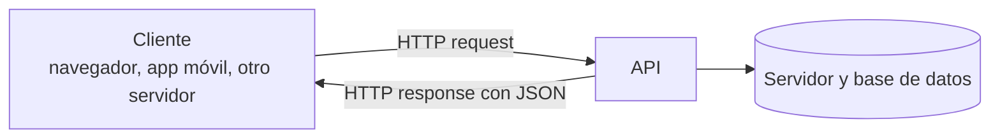

# APIs y APIs web

Una aplicación React dibuja la interfaz en el navegador, pero los datos (usuarios, publicaciones, compras) viven en un servidor. Para pedirlos, el frontend no le habla a la base de datos directamente: le habla a una **API**. Entender qué es una API y cómo se ve una por HTTP es la base de todo lo que sigue en el ramo, desde consumir APIs ajenas hasta construir la propia.

## Qué es una API

Una **API** (*Application Programming Interface*) es una interfaz, un intermediario entre una aplicación y quien quiera interactuar con ella **mediante código**.

- Se dice que una aplicación **expone** funcionalidades mediante una API.
- Quien quiera usar esas funcionalidades tiene que **consumir** la API.

El nombre lo dice: es una interfaz para que **otra aplicación**, no una persona, use el sistema. Hay APIs en todos los niveles:

```javascript
Math.max(5, 2, 100, 33);                  // la API de una librería del lenguaje
// expect(received).toBe(expected);       // la API de una librería de testing
// GET https://api.github.com/orgs/IIC2513/repos   // la API web de GitHub
```

## APIs web

Una **API web** es una API a la que se accede usando la infraestructura de la web, es decir, el protocolo **HTTP**. En términos generales, el cliente hace una request y recibe datos como respuesta. Esos datos no necesariamente son un documento HTML: casi siempre son **JSON** (y a veces XML).



Las URLs a las que se envían las requests se llaman **endpoints**. Por ejemplo, `GET https://api.github.com/orgs/IIC2513/repos` es el endpoint que lista los repositorios de una organización.

De forma genérica, las APIs web se conocen como **web services**:

- Sus respuestas contienen **datos estructurados** en un formato estándar, así que se puede asumir su estructura.
- Distintos tipos de aplicaciones pueden interpretar esas respuestas.
- Los formatos más usados son **JSON** y **XML**. JSON se impuso porque es más compacto y JavaScript lo lee de forma nativa.

```json
{ "id": 2, "name": "Ada", "courses": ["IIC2513", "IIC2413"] }
```

## La aplicación web moderna

En una aplicación web moderna, el **cliente** (computador, celular, tablet) recibe HTML, CSS y JS, y desde ahí se comunica con el **servidor**: un web server, la aplicación web y la base de datos. La API es la puerta de entrada al servidor. Muchos tipos de clientes la consumen:

- **frontends** de aplicaciones web, como una app en React que hace `fetch`;
- **apps móviles**;
- **backends** de otras aplicaciones (un servidor que llama a la API de pagos de otro);
- **dispositivos inteligentes**.

> [!tip] Una API, muchos clientes
> Como la API entrega datos y no pantallas, la misma API sirve a la web, a la app móvil y a integraciones externas. Cada cliente decide cómo presentar esos datos.

> [!warning] API no es lo mismo que backend
> El backend es todo lo que corre en el servidor (lógica, base de datos, tareas programadas). La API es solo la **interfaz** que el backend expone hacia afuera, es decir, el conjunto de endpoints que acepta y lo que responde en cada uno.

En Ingeniería de Software se construye una API de este tipo con Rails: [[15 - Construir una API JSON en Rails|Construir una API JSON en Rails]].

## Preguntas de repaso

> [!question]- ¿Qué significa que una aplicación "exponga" una API?
> Que ofrece un conjunto de operaciones a las que otras aplicaciones pueden acceder mediante código, con reglas definidas (en una API web: endpoints, métodos y formatos), sin conocer cómo está implementada por dentro.

> [!question]- ¿Por qué una API web responde con JSON y no con HTML?
> Porque sus clientes son programas que necesitan los datos para procesarlos o presentarlos a su manera. El HTML mezcla datos con presentación; JSON entrega solo la estructura de datos y cualquier lenguaje puede leerlo.

> [!question]- ¿Qué es un endpoint?
> Una URL de la API a la que se envían requests, como `/users` o `/repos/{owner}/{repo}/commits`. Junto con el método HTTP, identifica una operación concreta.
