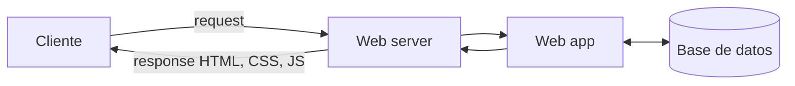

# Del servidor web a la aplicación web

¿Qué hay realmente del otro lado de una request HTTP? La respuesta cambió con los años: al principio había un programa que entregaba archivos HTML ya escritos, y hoy hay una aplicación que consulta bases de datos y genera cada respuesta. Recorrer esa evolución explica por qué un servidor moderno tiene varias capas y para qué sirve cada una.

## Los inicios: entregar archivos (1990-1993)

En la web original, el cliente pedía `…/page.html` y el **servidor web** buscaba ese archivo en su disco y lo devolvía. Un **servidor web** (*web server*) es la capa de software que recibe y entrega contenido, transmitiendo datos entre el navegador y el sistema. Provee la lógica que determina cómo se maneja cada solicitud, las conexiones y el tráfico.

Pronto los servidores entregaron más que HTML: imágenes (`/img.jpg`), scripts de JavaScript (desde 1995) y hojas de estilo CSS (1994-1996), todos como archivos.

| | **Apache HTTP Server** | **NGINX** |
|---|---|---|
| Origen | 1995, mantenido por la Apache Software Foundation | Desarrollo iniciado en 2002 |
| Enfoque | Sistema de módulos flexible y de alto rendimiento | Resolver el **problema C10k**: atender muchísimos clientes a la vez |
| Arquitectura | Procesos o hilos por conexión (según el módulo) | **Asíncrona y basada en eventos** |
| Uso | Dominante durante años | Hoy el más usado |

## Sitios estáticos y su límite

Un **sitio estático** tiene un documento por página. Una librería con 20 libros necesita 20 archivos HTML. ¿Y si son 100 libros? ¿Y si se quiere cambiar cómo se muestran todos? Hay que editar cada archivo a mano.

## Ejecutar código en el servidor

La solución fue que el servidor, además de entregar archivos, **ejecute programas** que generen el HTML:

- **mod_php**: módulo de Apache que ejecuta código PHP directamente. Una request a `…/book.php?id=1` corre el script con ese `id` y devuelve el HTML del libro 1.
- **CGI scripts**: programas en Perl, C o C++ que procesan datos en el servidor (por ejemplo, `…/cgi-bin/script.cgi`). Fueron el primer mecanismo para interactuar con bases de datos.

Así nace el **sitio dinámico**: el documento HTML se **genera** en cada request. A fines de los 90 y principios de los 2000 la complejidad creció, con varios scripts y una base de datos, y apareció la **aplicación web**: software que, a partir de una request HTTP, ejecuta acciones en el servidor y construye dinámicamente la respuesta que devuelve.

## Coordinación cliente-servidor

Mostrar una sola página implica varias idas y vueltas:

1. El cliente pide el recurso web.
2. El servidor consulta la base de datos.
3. El servidor genera el HTML.
4. El cliente recibe e interpreta el HTML.
5. El HTML referencia un CSS, así que el cliente lo pide al servidor.
6. El servidor devuelve el CSS y el cliente despliega la página con estructura y estilo.
7. El HTML referencia un script JS, así que el cliente lo pide al servidor.
8. El servidor devuelve el script y el cliente lo ejecuta.

> [!tip] Servidor web frente a aplicación web
> El servidor web (Apache, NGINX) maneja conexiones y entrega archivos estáticos. La aplicación web (Express, Rails) contiene la lógica que genera respuestas. En producción es común poner NGINX adelante, sirviendo los estáticos, y pasar el resto a la aplicación.

> [!warning] "Dinámico" se refiere a cómo se genera la respuesta
> Un sitio dinámico no es uno con animaciones, sino uno cuyo HTML se construye en el servidor para cada request, normalmente con datos de una base de datos.

## Preguntas de repaso

> [!question]- ¿Qué problema de los sitios estáticos resolvieron mod_php y CGI?
> El de tener un archivo HTML por cada página: con un script que genera el HTML a partir de parámetros y datos, una sola plantilla sirve para todos los libros, y cambiar el diseño se hace en un solo lugar.

> [!question]- ¿Qué es el problema C10k y cómo lo enfrenta NGINX?
> Es el desafío de atender unas diez mil conexiones simultáneas. NGINX lo enfrenta con una arquitectura asíncrona y basada en eventos, en vez de dedicar un proceso o hilo a cada conexión.

> [!question]- ¿Por qué cargar una página puede requerir varias requests?
> Porque el HTML referencia otros recursos (hojas de estilo, scripts, imágenes), y el navegador hace una request distinta por cada uno a medida que los encuentra.
