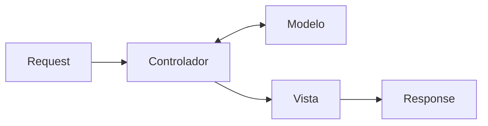

# Frontend, backend y frameworks web

Una aplicación web se reparte entre dos mundos con responsabilidades distintas: lo que corre en el navegador y lo que corre en el servidor. Para no escribir cada servidor desde cero existen los **frameworks web**, y para organizar el código dentro de ellos, el patrón **MVC**. Esta nota ubica cada pieza del stack del curso (React, Express y Sequelize) en ese mapa.

## Frontend y backend

| | **Frontend** (cliente) | **Backend** (servidor) |
|---|---|---|
| Pregunta | Cómo se ve | Cómo funciona |
| Foco | *Look & feel* | Lógica de negocio |
| Tecnologías | HTML, CSS, JS | Web server, web app, base de datos |
| Tareas | Estructura (HTML): el contenido de la página; presentación (CSS): layout y estilos; comportamiento (JS): la interacción con el usuario | Buscar y guardar datos en la base de datos, manejar sesiones de usuario, controlar el acceso al contenido, conectarse con otros servicios (correo, pagos) |

> [!warning] La seguridad vive en el backend
> Todo lo que corre en el frontend lo puede ver y modificar el usuario. Una validación o un control de permisos que solo existe en React se salta con DevTools. Las reglas que importan se verifican en el servidor.

## Lenguajes y frameworks web

Un **framework web** resuelve lo que todo servidor necesita (rutas, lectura de requests, respuestas, sesiones, acceso a datos), para que el programador se concentre en la lógica de su aplicación.

| Lenguaje | Frameworks |
|---|---|
| Node (JS) | Express, Koa |
| Python | Django, Flask |
| Ruby | Rails, Sinatra |
| .NET | ASP.NET, Blazor |
| Java | Spring, JSF, Struts |
| PHP | Laravel, CodeIgniter, Symfony |

## MVC

El patrón **Modelo-Vista-Controlador** separa una aplicación en tres responsabilidades. El **controlador** recibe la request, usa el **modelo** para leer o modificar datos y entrega el resultado a la **vista**, que arma la response.

En el proyecto del curso, cada pieza tiene una tecnología:

| Capa | Tecnología | Dónde corre |
|---|---|---|
| **Vista** | React | Cliente |
| **Controlador** | Express | Servidor |
| **Modelo** | Sequelize, sobre PostgreSQL | Servidor |

El patrón aplicado a Rails, donde las tres capas viven en el mismo framework, está en [[03 - Patrón MVC en Rails|Patrón MVC en Rails]].

## ¿Es React realmente MVC?

En estricto rigor, no. React es solo una librería para la capa de vista, no una solución MVC completa como Rails. Un patrón que describe mejor cómo se usa React es **MVVM** (*Model-View-ViewModel*):

- **Vista** (componentes): se dedica solo al renderizado y a la interacción del usuario.
- **ViewModel** (custom hooks o contexto): maneja la lógica de presentación, el estado y la transformación de datos.
- **Modelo**: los datos puros y las interacciones con APIs.

> [!tip] El stack completo
> El navegador ejecuta React (la vista). React pide datos con `fetch` a la API que expone Express (el controlador). Express usa Sequelize (el modelo) para hablar con PostgreSQL y responde con JSON, que React dibuja.

## Preguntas de repaso

> [!question]- ¿Qué tareas pertenecen al backend y no deberían resolverse solo en el frontend?
> Persistir y consultar datos, manejar sesiones, controlar el acceso al contenido e integrarse con servicios externos. Todo lo que el usuario no debe poder alterar tiene que decidirse en el servidor.

> [!question]- En el stack del curso, ¿qué hace cada pieza del MVC?
> React es la vista: dibuja la interfaz en el navegador. Express es el controlador: recibe las requests y coordina la respuesta. Sequelize es el modelo: representa los datos y se comunica con PostgreSQL.

> [!question]- ¿Por qué se dice que React encaja mejor en MVVM que en MVC?
> Porque React no tiene controlador ni modelo propios. Los componentes son la vista, y la lógica de estado que la alimenta (hooks y contexto) actúa como un ViewModel entre la vista y los datos.
