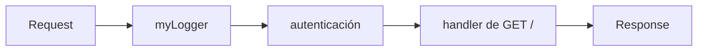

# Middleware y acceso a datos en el servidor

Con React como vista, faltan las otras dos piezas del MVC: el **controlador**, que recibe las requests, y el **modelo**, que habla con la base de datos. En el curso son **Express** y **Sequelize**. Esta nota presenta las dos ideas que las organizan: el **middleware**, que estructura cómo Express procesa una request, y las capas de abstracción para llegar a la base de datos sin escribir SQL a mano.

## Express

**Express** es un framework web para Node.js, creado en 2010, pensado para ser **minimalista y flexible** y construir servidores HTTP de alto rendimiento. Cada ruta se declara con el patrón `app.METHOD(PATH, HANDLER)`:

```javascript
const express = require('express');
const app = express();

app.get('/', (req, res) => {
  res.send('Hello World!');
});

app.listen(3000);
```

## Middleware

Un **middleware** es una pieza de software que se ubica **entre** el cliente y el servidor e interactúa con las requests y las respuestas que pasan entre ambos. Tareas típicas de un middleware son la autenticación, la validación, el registro (*logging*) y el manejo de transacciones.

En Express, un middleware es una función que recibe `req`, `res` y **`next`**. Puede leer o modificar la request, responder directamente o llamar a `next()` para pasar el control al siguiente middleware de la cadena:

```javascript
const myLogger = function (req, res, next) {
  console.log('LOGGED');
  next();                 // sin esto, la request queda colgada
};

app.use(myLogger);        // se aplica a todas las rutas

app.get('/', (req, res) => {
  res.send('Hello World!');
});
```



> [!tip] Una cadena de funciones
> Toda request recorre los middlewares en el orden en que se registraron con `app.use`. Cada uno decide si la deja pasar (`next()`) o la corta respondiendo. Así se reutiliza la misma lógica (por ejemplo, verificar el token) en muchas rutas.

> [!warning] Olvidar `next()`
> Si un middleware no llama a `next()` ni envía una respuesta, la request nunca termina y el cliente queda esperando hasta agotar el tiempo.

## Hablar con la base de datos

El objetivo es conectar la aplicación a la base de datos sin tener que lidiar con SQL en todas partes. Hay tres niveles de abstracción:

1. **Driver de la base de datos**: la librería que permite conectarse a un motor particular y enviarle SQL. Para PostgreSQL es `pg` (con `pg-hstore`). Hay otros para MySQL (`mysql2`), MariaDB, SQLite (`sqlite3`), SQL Server (`tedious`) y Oracle (`oracledb`).
2. **Query builder**: una capa intermedia que permite construir consultas con métodos de JavaScript, con una sintaxis parecida a SQL. Un ejemplo es **Knex**, opcional en el proyecto.
3. **ORM** (*Object-Relational Mapping*): separa el lenguaje de programación del trabajo directo con la base de datos. Las tablas se manejan como clases y las filas como objetos, y la librería encapsula el SQL. En el curso se usa **Sequelize**.


> [!example]- Transcripción de la imagen
> "Lo que no queremos es tener que lidiar con SQL". De izquierda a derecha: **Application** ↔ **ORM** ↔ **database driver** ↔ **Database**, con flechas bidireccionales entre cada par.

```bash
npm install --save sequelize pg pg-hstore   # ORM + driver de PostgreSQL
```

Los ORMs, sus ventajas y sus problemas de rendimiento se ven en detalle en [[03 - ORMs|ORMs]] y [[06 - Rendimiento y ORMs|Rendimiento y ORMs]].

## Preguntas de repaso

> [!question]- ¿Qué hace `next()` en un middleware de Express?
> Pasa el control al siguiente middleware o handler de la cadena. Sin él (y sin enviar una respuesta), la request queda sin terminar.

> [!question]- ¿Por qué conviene implementar la autenticación como middleware?
> Porque es la misma verificación para muchas rutas. Escrita una vez y registrada con `app.use` (o en las rutas que la necesitan), evita repetir código y asegura que ninguna ruta protegida se la salte.

> [!question]- ¿Qué diferencia hay entre un driver, un query builder y un ORM?
> El driver solo conecta y ejecuta SQL escrito a mano. El query builder genera el SQL a partir de métodos encadenados. El ORM va más allá: representa las tablas como clases y las filas como objetos, y genera el SQL por debajo.
