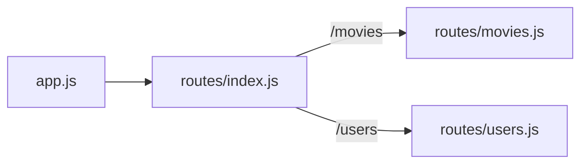

# Rutas y routers en Express

Una API tiene decenas de endpoints. Si todos se declaran en `app.js`, el archivo se vuelve inmanejable. Express resuelve esto con **routers**: mini-aplicaciones que agrupan las rutas de un recurso y se montan bajo un prefijo. Así cada recurso (películas, usuarios) vive en su propio archivo.

## Routing básico

Una ruta combina un **método**, un **path** y un **handler**: `app.METHOD(PATH, HANDLER)`. El handler recibe `req` y `res`:

```javascript
app.get('/movies', (req, res) => res.json([]));          // listar
app.post('/movies', (req, res) => res.status(201).json(req.body));  // crear
app.get('/movies/:id', (req, res) => res.send(req.params.id));      // obtener uno
```

- **Parámetros de ruta**: `:id` captura ese segmento de la URL en `req.params.id`.
- **Query string**: `?genre=drama` llega en `req.query.genre`.
- **Body**: con `app.use(express.json())`, el JSON llega en `req.body`.

## El primer router

1. Crear la carpeta `src/routes/`.
2. Escribir el router del recurso en `src/routes/movies.js`.
3. Montarlo en `src/app.js` bajo su prefijo.
4. Probar `localhost:3000/movies`.

```javascript
// src/routes/movies.js
const express = require('express');

const router = express.Router();

router.get('/', (req, res) => {
  res.send('GET /movies');
});

module.exports = router;
```

```javascript
// src/app.js
const express = require('express');
const movies = require('./routes/movies');

const app = express();
app.use('/movies', movies);     // todas las rutas del router quedan bajo /movies
app.listen(3000);
```

Dentro del router, `'/'` significa "la raíz del prefijo": `router.get('/')` responde a `GET /movies`, y `router.get('/:id')` a `GET /movies/7`.

## Un router índice

Con varios recursos conviene un router principal que monte a los demás, para que `app.js` solo conecte uno:

```javascript
// src/routes/index.js
const express = require('express');
const moviesRouter = require('./movies');
const usersRouter = require('./users');

const router = express.Router();

router.use('/movies', moviesRouter);
router.use('/users', usersRouter);
// ... más routers si los hubiese

module.exports = router;     // en app.js: app.use('/', require('./routes'));
```



> [!tip] Un archivo por recurso
> Cada router agrupa el CRUD de un recurso. Agregar un recurso nuevo es crear su archivo y sumar una línea en el router índice, sin tocar los demás.

## Responder con el código correcto

Un handler debe devolver un código coherente con lo que pasó, no siempre 200:

| Situación | Respuesta |
|---|---|
| Listar u obtener con éxito | `res.json(datos)` (200) |
| Recurso creado | `res.status(201).json(nuevo)` |
| Borrado sin contenido | `res.status(204).end()` |
| Datos inválidos | `res.status(400).json({ error })` |
| No existe | `res.status(404).json({ error })` |
| Lista vacía | `res.status(200).json([])`: no es un error |

> [!warning] Una lista vacía no es un 404
> Si un recurso existe pero no tiene elementos (un producto sin reseñas), la respuesta correcta es `200` con `[]`. Un 404 indica que lo pedido **no existe**, y haría que el frontend lo trate como un error.

## Preguntas de repaso

> [!question]- Si un router define `router.get('/:id')` y se monta con `app.use('/movies', router)`, ¿qué URL atiende?
> `GET /movies/:id`, por ejemplo `/movies/7`. El prefijo del montaje se antepone a todas las rutas del router.

> [!question]- ¿Dónde llegan el `7` de `/movies/7`, el `drama` de `?genre=drama` y el JSON de un `POST`?
> En `req.params.id`, en `req.query.genre` y en `req.body` (este último solo si se registró `express.json()`).

> [!question]- ¿Qué gana una API con un router índice?
> Que `app.js` monta un solo router y cada recurso queda en su propio archivo. La API crece agregando routers sin modificar el código existente.
