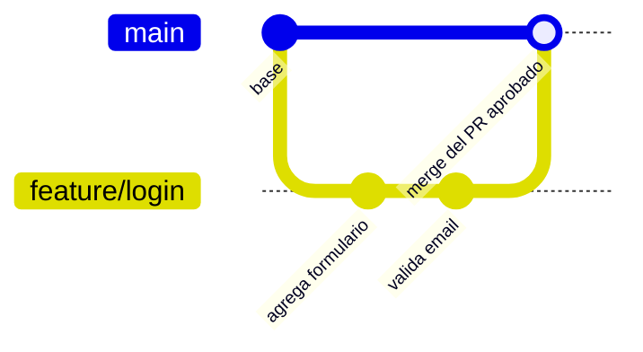

# Code review, GitHub flow y commits

Un linter detecta problemas de forma, pero no si una solución es buena, si se le escapó un caso o si hay una manera más simple de hacerla. Para eso está la revisión entre personas. En equipos que usan GitHub, el code review vive dentro de un flujo de trabajo concreto, el **GitHub flow**, y depende de commits bien escritos.

## Code review

El **code review** es la revisión del código por parte de pares (desarrolladores del proyecto o externos). Busca detectar errores, asegurar buenas prácticas y, eventualmente, encontrar mejores soluciones. El resultado de una revisión son sugerencias o solicitudes de cambio, y en general los cambios deben ser **aprobados** antes de integrarse al repositorio compartido.

Se gana:

- detectar errores temprano;
- asegurar buenas prácticas y el cumplimiento de la guía de estilo;
- encontrar mejores formas de resolver problemas;
- aprender del código revisado;
- mejorar la comunicación del equipo;
- documentar el diseño y la toma de decisiones.

El flujo típico:

1. El autor implementa la funcionalidad y solicita revisión.
2. El revisor pide cambios o da sugerencias.
3. El autor hace los cambios y pide una nueva revisión.
4. El revisor aprueba.
5. El autor integra los cambios.

> [!tip] Revisar código, no personas
> **Como autor**: no tomarse los comentarios como algo personal, mantener una actitud humilde y receptiva, y defender las posturas con argumentos. **Como revisor**: recordar que el feedback va a una persona, mantener una intención positiva y constructiva, sugerir alternativas en vez de imponer "la" solución, argumentar cada cambio pedido y destacar las buenas soluciones.

## GitHub flow

El **GitHub flow** es un flujo de desarrollo apoyado en GitHub con reglas simples:

- La rama principal es `main` y **siempre está estable**, en condiciones de usarse.
- La revisión de código se hace en **Pull Requests** (PRs).



1. Cada funcionalidad se implementa en una **rama nueva** (*feature branch*), creada desde `main`.
2. Se agregan commits con los cambios de esa funcionalidad.
3. Al terminar, se abre un **Pull Request**.
4. El PR se asigna a revisores, que piden cambios o aprueban.
5. Si piden cambios, se agregan nuevos commits a la misma rama.
6. Se repiten los pasos 4 y 5 hasta que el PR se aprueba (o se cierra).
7. Aprobado el PR, se hace **merge** desde GitHub.

Para contribuir a un repositorio ajeno, el flujo empieza con un **fork** (una copia en la cuenta propia) y el PR se abre desde el fork hacia el repositorio original.

## Commits con propósito

Un **commit** es un conjunto empaquetado de cambios, con un mensaje y un identificador (*hash* o *SHA*). Cada commit debe tener **un propósito**, reflejado en su mensaje, y así sirve como documentación del proceso de desarrollo. Estructura:

```text
<encabezado: resumen breve del cambio>
                                         ← línea en blanco
<cuerpo: explicación detallada, el porqué del cambio>
```

Cada proyecto define una convención, que siguen sus mantenedores y contribuidores:

| Convención | Formato | Ejemplo |
|---|---|---|
| **Angular** | `<type>(<scope>): <summary>` | `docs: fix typo in installation guide` |
| **Conventional Commits** | `<type>[optional scope]: <summary>` con cuerpo y *footers* opcionales | `fix: prevent racing of requests` |
| **Platanus** | `tipo(contexto): descripción` | `fix(ui/SignUpForm): validate username availability` |

Los tipos más comunes son `feat`, `fix`, `docs`, `refactor` y `test`.

> [!warning] "cambios" no es un mensaje
> Un historial de commits llamados "fix", "cambios" o "ahora sí" no documenta nada. Dentro de seis meses, el mensaje es lo único que explica por qué se hizo un cambio.

## Preguntas de repaso

> [!question]- ¿Por qué en GitHub flow `main` debe estar siempre estable?
> Porque es la versión que se puede desplegar en cualquier momento y desde la que se crean las nuevas ramas. Todo trabajo en curso vive en feature branches, y solo entra a `main` después de revisión y aprobación.

> [!question]- ¿Qué ventaja tiene una convención como Conventional Commits?
> Que los mensajes los entienden tanto personas como herramientas: se puede generar un changelog automático, decidir el número de versión según los tipos (`feat`, `fix`) y filtrar el historial.

> [!question]- Además de encontrar errores, ¿qué aporta el code review a un equipo?
> Difunde el conocimiento del código, hace que todos aprendan unos de otros, mejora la comunicación y deja registrada en el PR la discusión de diseño y las decisiones tomadas.
