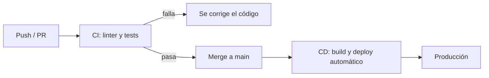

# Integración y despliegue continuos

Las prácticas de calidad sirven solo si se aplican siempre, y las personas se olvidan. La solución es **automatizarlas**: que cada push ejecute el linter y los tests (**integración continua**) y que cada cambio aprobado llegue a producción sin pasos manuales (**despliegue continuo**).

## Integración continua (CI)

La **integración continua** (*Continuous Integration*, CI) es una metodología que promueve integrar los cambios al código **continuamente** durante el desarrollo, en vez de juntar todo al final. Busca bajar el costo de integrar y **detectar fallas temprano**. Es buena práctica automatizarla con herramientas como Jenkins, CircleCI, Travis CI, Codeship o, integrada a GitHub, **GitHub Actions**.

## GitHub Actions

GitHub Actions automatiza tareas dentro de GitHub:

- Un **workflow** es un procedimiento automatizado, definido en un archivo YAML en `.github/workflows/`.
- Un workflow tiene uno o más **jobs**, y lo gatilla un **evento** (un push, un PR).
- Cada job corre en una máquina virtual (*runner*) y ejecuta una secuencia de **steps**.

Con workflows se pueden compilar *builds*, correr tests, empaquetar y publicar código, lanzar versiones o desplegar.

```yaml
# .github/workflows/demo.yml
name: Demo
run-name: Primera GitHub Action de ${{ github.actor }}
on: [push]
jobs:
  Mi-primera-GitHub-Action:
    runs-on: ubuntu-latest
    steps:
      - run: echo "Evento de tipo ${{ github.event_name }}."
      - run: echo "Job corriendo en ${{ runner.os }}."
      - name: Clonando desde el repositorio
        uses: actions/checkout@v4
      - name: Listando los contenidos del repositorio
        run: ls ${{ github.workspace }}
      - run: echo "El status de este job es ${{ job.status }}."
```

Al hacer push, la pestaña *Actions* del repositorio muestra la ejecución y el output de cada step. Un workflow que corre el linter:

```yaml
# .github/workflows/eslint.yml
name: Linter
run-name: Ejecutando ESLint
on: [push]
jobs:
  Ejecutando-ESLint:
    runs-on: ubuntu-latest
    steps:
      - uses: actions/checkout@v4
      - name: Install modules
        run: yarn
      - name: Run ESLint
        run: yarn run eslint .
```

Si el código tiene errores de linter, `eslint` termina con código de salida distinto de 0 y el **job falla**: GitHub lo marca en rojo en el commit y en el PR. Se corrige localmente (por ejemplo, con `yarn run eslint . --fix`), se hace push y el workflow vuelve a correr, esta vez con éxito.

> [!tip] CI como guardián de `main`
> Combinado con GitHub flow, un PR solo se integra si los checks de CI pasan. Así la regla de que `main` está siempre estable la hace cumplir una máquina, no la memoria del equipo.

## Despliegue continuo (CD)

El **despliegue continuo** (*Continuous Deployment*, CD) mantiene la capacidad de cambiar la versión de la aplicación **en cualquier momento**. Busca reducir el tiempo de entrega y hacer reproducible el despliegue, eliminando los pasos manuales. Herramientas habituales:

- **Docker**, para empaquetar la aplicación en contenedores y desplegarla siempre igual;
- **Kubernetes**, para orquestar esos contenedores;
- **Terraform**, para definir la infraestructura como código.



Servicios de hosting con despliegue automático desde GitHub:

| Servicio | Uso típico |
|---|---|
| **GitHub Pages** | Sitios estáticos y frontends |
| **Render** | Aplicaciones cloud; la recomendación para el backend del proyecto |
| **Netlify** | Aplicaciones cloud, sobre todo frontends |
| **Vercel** | Aplicaciones cloud, especialmente frontends y Next.js |

> [!warning] Continuous delivery frente a continuous deployment
> En la entrega continua (*delivery*) cada cambio queda **listo** para producción, pero alguien aprueba el paso final. En el despliegue continuo (*deployment*) ese paso también es automático.

Los contenedores se ven en detalle en [[07 - Contenedores con Docker y Kubernetes|Contenedores con Docker y Kubernetes]].

## Preguntas de repaso

> [!question]- ¿Qué gana un equipo al integrar cambios continuamente en vez de al final?
> Los conflictos y errores aparecen cuando el cambio es pequeño y reciente, así que son fáciles de entender y corregir. Integrar todo al final acumula conflictos y fallas difíciles de rastrear.

> [!question]- ¿Cómo sabe GitHub Actions que un step falló?
> Por el código de salida del comando: si es distinto de 0 (por ejemplo, ESLint con errores), el step falla, el job se marca como fallido y GitHub lo muestra en el commit y en el PR.

> [!question]- ¿Qué tienen en común Docker y Terraform dentro de CD?
> Ambos hacen reproducible el despliegue: Docker empaqueta la aplicación con todo su entorno y Terraform describe la infraestructura como código. Así cada despliegue es idéntico y no depende de pasos manuales.
