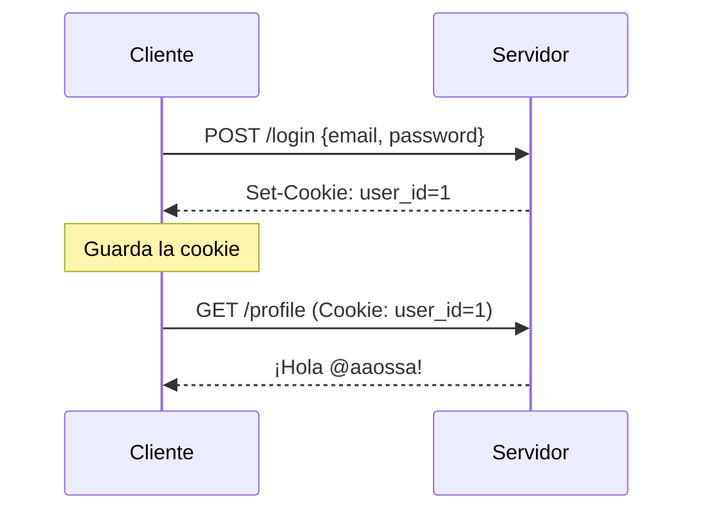

# Cookies y el header Set-Cookie

Un servidor atiende a muchos clientes a la vez, y HTTP no tiene estado: cada request llega sin memoria de las anteriores. Pero una aplicación necesita saber **quién** hace cada request, para autenticar al usuario y mantener el estado de cada navegador activo (*session state*). La herramienta más antigua y común para lograrlo son las **cookies**.

## Almacenamiento del lado del cliente

El navegador ofrece varias formas de guardar datos, de distinta duración y complejidad:

| Mecanismo | Para qué |
|---|---|
| **Cookies** | La forma más tradicional de guardar pequeñas piezas de información; viajan solas en cada request |
| **Web Storage API** | Datos pequeños (solo strings), con distintos niveles de persistencia y control total desde JavaScript |
| **IndexedDB API** | Una base de datos completa en el navegador, para datos complejos (objetos de JS) |
| **Cache API** | Guardar requests y respuestas para responder rápido; también sirve de almacén |

Esta nota trata las cookies; las demás se ven en el tema de almacenamiento en el cliente.

## Qué es una cookie

Una **cookie** es un dato (un par `nombre=valor`) que el **servidor envía al navegador**, y que el navegador devuelve en las requests siguientes. Su objetivo es que el servidor sepa si dos requests vienen **del mismo cliente**. Usos típicos:

- manejo de sesión;
- personalización y recordar preferencias;
- anuncios, analytics y tracking;
- A/B testing;
- seguridad (por ejemplo, tokens contra CSRF);
- coordinación entre accesos.

## Cómo funcionan

1. El servidor envía la cookie en la **response**, con el header `Set-Cookie`, y el navegador la guarda.
2. El navegador la incluye automáticamente en las **requests siguientes** a ese sitio, con el header `Cookie`.

```http
HTTP/1.1 200 OK
Set-Cookie: nombre_cookie=valor_cookie
```

```http
GET /buscar HTTP/1.1
Cookie: llave=valor; otra=otro_valor
```

Se puede ver en cualquier sitio. Al abrir `buscacursos.uc.cl` por primera vez (o en modo incógnito), la pestaña *Network* de DevTools muestra un `Set-Cookie` en la respuesta. En las búsquedas siguientes, esa cookie aparece en el header `Cookie` de cada request.



## Atributos de `Set-Cookie`

La respuesta puede agregar directivas a cada cookie:

| Atributo | Efecto |
|---|---|
| `Expires=<fecha>` / `Max-Age=<segundos>` | Tiempo de vida máximo; sin ellos, la cookie dura lo que la sesión del navegador |
| `Domain=<dominio>` | Hosts a los que se puede enviar la cookie |
| `Path=<ruta>` | Solo se incluye en requests a esa ruta o sus subrutas |
| `Secure` | Solo se envía por HTTPS |
| `HttpOnly` | JavaScript no puede leerla (`document.cookie` no la ve) |
| `SameSite=Strict\|Lax\|None` | Controla si se envía en requests que vienen de otros sitios |

```http
Set-Cookie: id=a3fWa; Expires=Wed, 21 Oct 2021 07:28:00 GMT; Secure; HttpOnly
```

> [!tip] Las tres banderas de una cookie de sesión
> `HttpOnly` evita que un script malicioso (XSS) la robe, `Secure` evita que viaje sin cifrar y `SameSite` limita su envío desde otros sitios (CSRF). Una cookie de sesión debería llevar las tres.

> [!warning] ¿Qué está mal en `Set-Cookie: user_id=1`?
> La cookie vive en el navegador y el usuario puede editarla. Si cambia `user_id=1` por `user_id=2`, el servidor lo tratará como otra persona. Una cookie nunca debe contener un dato que el servidor crea a ciegas; la solución son las **sesiones**.

Las cookies vistas desde la teoría de redes están en [[04 - Protocolo HTTP, formato de mensajes y estado con cookies|Protocolo HTTP y cookies]].

## Preguntas de repaso

> [!question]- ¿Cómo sabe el servidor que dos requests vienen del mismo navegador?
> Porque en la primera respuesta le entregó una cookie con `Set-Cookie`, y el navegador la incluye automáticamente en el header `Cookie` de cada request siguiente.

> [!question]- ¿Qué protege el atributo `HttpOnly` y qué no protege?
> Impide que JavaScript lea la cookie, así que un ataque XSS no puede robarla con `document.cookie`. No impide que el navegador la envíe, ni que alguien la vea si viaja por HTTP sin cifrar (para eso está `Secure`).

> [!question]- ¿Por qué no basta con guardar `user_id` en una cookie para saber quién es el usuario?
> Porque el cliente controla sus cookies y puede cambiar el valor para hacerse pasar por otro usuario. El servidor necesita un identificador que no se pueda adivinar ni falsificar, y verificarlo de su lado.
