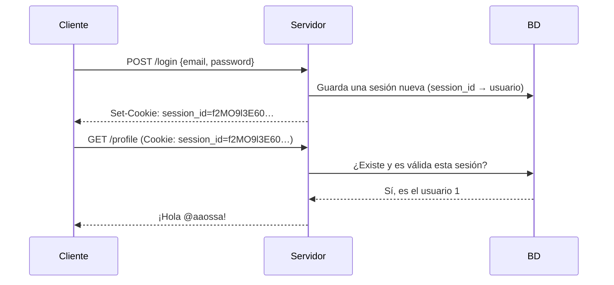

# Sesiones de usuario

Guardar `user_id=1` en una cookie permite que cualquiera se haga pasar por otro con solo editarla. Hace falta algo que el servidor pueda **verificar**. Una **sesión** resuelve el problema: el navegador guarda solo un identificador aleatorio, y lo que ese identificador significa vive en el servidor.

## Qué es una sesión

Una **sesión de usuario** es una forma de reconocer específicamente a un usuario a lo largo de requests sucesivas. Hay dos estrategias para manejarla:

1. **Enviar los datos de la sesión** (las credenciales o la identidad) en una o más cookies.
2. Que la cookie incluya **solo un identificador de sesión** (*session id*), y que los datos queden en el servidor.

La segunda es la habitual, porque el cliente nunca tiene en sus manos nada que pueda modificar con provecho.

## El flujo con un identificador de sesión



1. El usuario inicia sesión con sus credenciales.
2. El servidor las verifica, genera un `session_id` **aleatorio y largo**, y guarda en la base de datos a qué usuario pertenece.
3. El servidor responde con `Set-Cookie: session_id=…`.
4. En cada request, el navegador devuelve la cookie, y el servidor busca la sesión en la base de datos para identificar al usuario.

> [!tip] Por qué un id aleatorio es seguro
> Un `session_id` de 32 bytes aleatorios tiene $2^{256}$ valores posibles: adivinar uno válido es impracticable. Y aunque el usuario lo edite, solo consigue un id que no existe en el servidor.

## Cookies frente a sesiones

Ambas sirven para mantener datos entre distintas páginas de un mismo sitio. La diferencia conceptual es **dónde se almacenan**:

| | **Cookie** | **Sesión** |
|---|---|---|
| Dónde vive | En el **cliente** (navegador) | En el **servidor** (memoria, BD, Redis) |
| Quién puede modificarla | El usuario | Solo el servidor |
| Qué viaja en cada request | La cookie completa | Solo el identificador, dentro de una cookie |

Ambas se combinan: la sesión vive en el servidor, y la cookie solo transporta su identificador.

## En Express

Express escribe cookies con `res.cookie(nombre, valor, opciones)`. Para leerlas se usa el middleware `cookie-parser`, que las deja en `req.cookies`:

```javascript
const express = require('express');
const cookieParser = require('cookie-parser');
const crypto = require('crypto');

const app = express();
app.use(cookieParser());

const sessions = new Map();   // session_id → userId (en producción: BD o Redis)

app.post('/login', (req, res) => {
  // ... verificar email y contraseña ...
  const sessionId = crypto.randomBytes(32).toString('hex');
  sessions.set(sessionId, 1);
  res.cookie('session_id', sessionId, {
    httpOnly: true, secure: true, sameSite: 'lax', maxAge: 60 * 60 * 1000,   // maxAge en ms
  });
  res.send('Sesión iniciada');
});

app.get('/profile', (req, res) => {
  const userId = sessions.get(req.cookies.session_id);
  if (!userId) return res.status(401).send('No autenticado');
  res.send(`¡Hola usuario ${userId}!`);
});

app.post('/logout', (req, res) => {
  sessions.delete(req.cookies.session_id);   // invalidar en el servidor
  res.clearCookie('session_id');
  res.send('Sesión cerrada');
});
```

`res.cookie` genera el header `Set-Cookie: session_id=…; Max-Age=3600; Path=/; HttpOnly; Secure; SameSite=Lax`. En Express, `maxAge` se da en milisegundos, pero el header lo expresa en segundos.

> [!warning] Cerrar sesión es borrarla en el servidor
> `clearCookie` solo le pide al navegador que olvide la cookie. Si la sesión no se borra también en el servidor, alguien que copió el `session_id` puede seguir usándolo. Con sesiones en el servidor, revocar es fácil, a diferencia de los tokens autocontenidos.

## Preguntas de repaso

> [!question]- ¿Por qué el `session_id` debe ser aleatorio y no un número correlativo?
> Porque si fuera correlativo (1, 2, 3…), un atacante podría probar valores vecinos y secuestrar sesiones ajenas. Un valor aleatorio y largo es imposible de adivinar.

> [!question]- ¿Qué diferencia conceptual hay entre una cookie y una sesión?
> La cookie se almacena en el cliente y el usuario la puede modificar. La sesión se almacena en el servidor; el cliente solo guarda su identificador, dentro de una cookie.

> [!question]- ¿Qué debe hacer el servidor al cerrar sesión, además de borrar la cookie?
> Eliminar o invalidar la sesión en su almacenamiento, para que el identificador deje de ser válido aunque alguien lo haya copiado.
