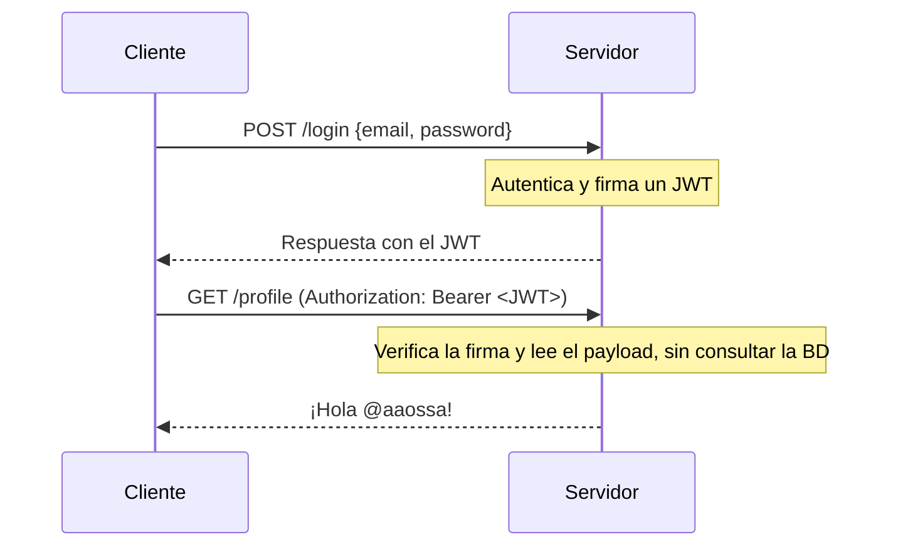

# JSON Web Tokens

Con sesiones, el estado vive en el servidor: cada request obliga a buscar el `session_id` en la base de datos. Un **JSON Web Token** (JWT) lleva la información dentro del propio token, **firmada**, de modo que el servidor puede confiar en ella sin consultar nada. Es una herramienta poderosa, pero no reemplaza a las sesiones en todos los casos.

## Qué es un JWT

Un JWT es un **estándar abierto** (RFC 7519) que define una forma compacta y autocontenida de transmitir información de forma segura entre dos partes, como un objeto JSON. La información es confiable porque está **firmada digitalmente**: con un secreto (algoritmo HMAC) o con un par de claves pública y privada (RSA o ECDSA).

## Estructura

Un JWT son tres partes en base64url separadas por puntos: `header.payload.signature`.


> [!example]- Transcripción de la imagen
> Un JSON Web Token con tres partes:
> - **Header**: `{"typ": "JWT", "alg": "HS256"}`.
> - **Payload**: `{"sub": "user10001", "iat": 1569302116, "role": "admin", "user_id": "user10001"}`.
> - **Signature**: `HMAC-SHA256(base64urlEncoding(header) + '.' + base64urlEncoding(payload), secret_salt)`.

- El **header** indica el tipo y el algoritmo de firma.
- El **payload** contiene los datos (*claims*): `sub` (el sujeto, típicamente el id del usuario), `iat` (cuándo se emitió), `exp` (cuándo expira) y datos propios como el rol.
- La **firma** se calcula sobre el header y el payload con un **secreto** que solo conoce el servidor (en la figura aparece como `secret_salt`).

Si alguien modifica el payload (por ejemplo, cambia `role` a `admin`), la firma ya no coincide y el servidor rechaza el token.

## El flujo



## En Express

```javascript
const jwt = require('jsonwebtoken');
const { expressjwt: expressJwt } = require('express-jwt');

const JWT_SECRET = process.env.JWT_SECRET;

app.post('/login', (req, res) => {
  // ... verificar credenciales ...
  const payload = { sub: user.id, username: user.username };   // sin datos sensibles
  const token = jwt.sign(payload, JWT_SECRET, { expiresIn: '1h' });
  res.json({ token });
});

const authenticate = expressJwt({
  secret: JWT_SECRET,
  algorithms: ['HS256'],
  requestProperty: 'auth',        // el payload queda en req.auth
});

app.get('/protected', authenticate, (req, res) => {
  res.json({ message: `Hello ${req.auth.username}`, userId: req.auth.sub });
});
```

Sin token, o con un token alterado, `express-jwt` responde `401`.

## Consideraciones

- El payload debe ser **breve y preciso** (*compact*).
- Los JWT están **codificados y firmados, no encriptados**: cualquiera decodifica el payload con base64. **Nunca** se ponen datos sensibles ahí.
- Un JWT no busca ocultar información, sino hacerla **confiable**: garantiza su integridad y autenticidad.
- Para proteger el header `Authorization` en tránsito se usa HTTPS.

## Cerrar sesión y JWT frente a sesiones

Con una cookie de sesión, basta con borrarla del cliente y del servidor. Un JWT, en cambio, sigue siendo válido hasta que expira, aunque el usuario "cierre sesión". Para revocarlo hay que usar una **expiración corta** o una **lista de tokens revocados** (*denylist*). Pero ambas estrategias vuelven a guardar estado en el servidor o mantienen sesiones activas más tiempo del debido, y así se pierde la ventaja del JWT.

> [!warning] No usar JWT como token de sesión
> JWT no ofrece por sí solo un beneficio sobre las sesiones: la única diferencia es **dónde vive el estado** (en el cliente o en el servidor). Para manejar la sesión de una aplicación web conviene una sesión clásica. Los JWT se recomiendan para **APIs** y arquitecturas de autenticación más complejas, como OAuth.

> [!warning] Nunca guardar tokens en `localStorage`
> `localStorage` es accesible desde JavaScript, así que un ataque XSS puede robar el token. Una cookie `HttpOnly` no se puede leer desde scripts.

## Preguntas de repaso

> [!question]- Si el payload de un JWT se lee con base64, ¿qué impide que un usuario se cambie el rol a `admin`?
> La firma: se calcula sobre el header y el payload con un secreto que solo tiene el servidor. Al cambiar el payload la firma deja de coincidir, y el usuario no puede recalcularla sin el secreto.

> [!question]- ¿Por qué es difícil cerrar sesión con un JWT?
> Porque el token es válido hasta que expira y el servidor no guarda una lista de tokens emitidos. Revocarlo antes exige una denylist o expiraciones cortas, que reintroducen estado en el servidor.

> [!question]- ¿Qué diferencia de fondo hay entre una sesión y un JWT?
> Dónde se guarda el estado de la sesión: con sesiones, en el servidor (BD o memoria); con JWT, en el cliente, dentro del token firmado.
