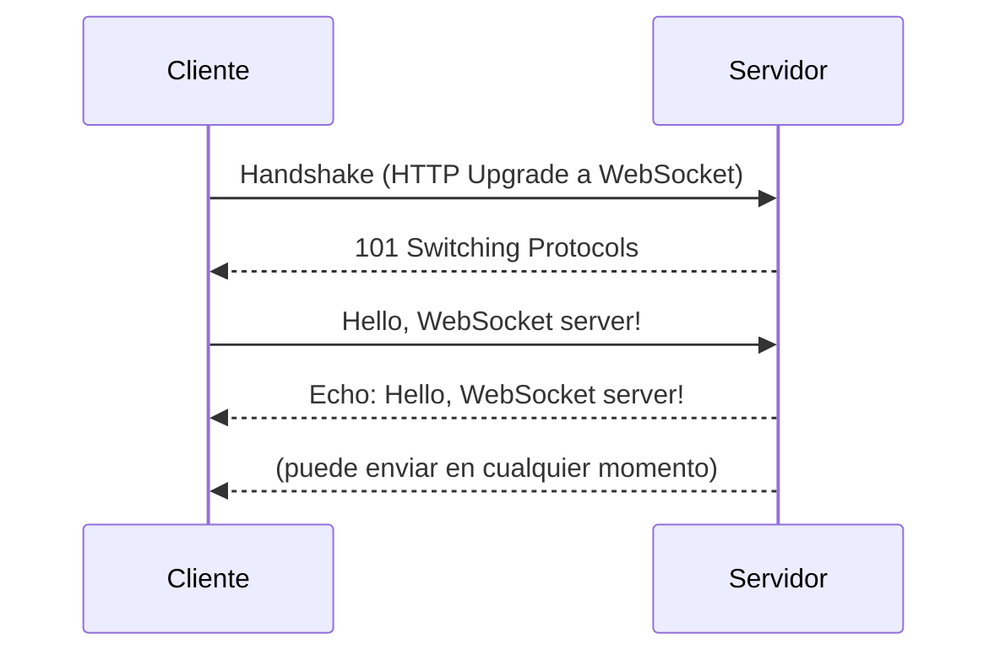

# WebSockets y comunicación en tiempo real

En HTTP el cliente siempre pregunta y el servidor solo responde. Para un chat, un marcador deportivo en vivo o un documento colaborativo, eso obliga al cliente a preguntar una y otra vez "¿hay algo nuevo?". Los **WebSockets** cambian el modelo: una conexión que queda abierta y por la que **ambos** lados pueden enviar mensajes cuando quieran.

## APIs de comunicación del navegador

| API | Dirección | Uso |
|---|---|---|
| **Fetch API** | Cliente → servidor (request-respuesta) | La forma moderna de hacer requests HTTP, con promesas |
| **WebSocket API** | Bidireccional, conexión persistente | Aplicaciones en tiempo real: chats, notificaciones |
| **Server-Sent Events** (SSE) | Servidor → cliente | Un canal unidireccional para recibir actualizaciones constantes |
| **WebRTC** | Directa entre navegadores | Audio, video o datos en tiempo real, sin intermediarios |

## WebSockets

**WebSockets** es un protocolo que permite la interacción **bidireccional en tiempo real** entre cliente y servidor. A diferencia de HTTP, mantiene una **conexión persistente**, sobre un socket TCP.

Sin WebSockets, la alternativa es el ***polling***: el cliente hace un `GET` cada cierto tiempo, y la mayoría de las respuestas son "nada nuevo". Con WebSockets hay un solo saludo inicial (que empieza como una request HTTP y se "actualiza" a WebSocket), y desde ahí los mensajes fluyen en ambas direcciones sin nuevas requests.

Aplicaciones típicas:

- chats en vivo;
- *broadcasting* de información, como marcadores deportivos en vivo;
- sincronizar datos entre clientes, como las respuestas de un Menti;
- colaboración entre varios usuarios, como en Figma.

## Un servidor de eco con Node

El servidor usa la librería `ws` y escucha en el puerto 8080. Cuando un cliente se conecta, registra listeners para sus mensajes y para la desconexión, y devuelve cada mensaje recibido:

```javascript
const WebSocket = require('ws');

const wss = new WebSocket.Server({ port: 8080 });

wss.on('connection', (ws) => {
  console.log('Client connected');

  ws.on('message', (message) => {
    console.log(`Received: ${message}`);
    ws.send(`Echo: ${message}`);          // devolver el mensaje al cliente
  });

  ws.on('close', () => console.log('Client disconnected'));
});
```

## El cliente en el navegador

El navegador trae la clase `WebSocket`. Las URLs usan el esquema `ws://` (o `wss://`, cifrado con TLS):

```javascript
const ws = new WebSocket('ws://localhost:8080');

ws.addEventListener('open', () => {
  console.log('Connected to WebSocket server');
  ws.send('Hello, WebSocket server!');
});

ws.addEventListener('message', (event) => {
  console.log(`Received: ${event.data}`);   // "Echo: Hello, WebSocket server!"
});

ws.addEventListener('close', () => console.log('Disconnected from WebSocket server'));
```



## Socket.IO

**Socket.IO** es una librería construida sobre WebSockets que facilita su uso: reconexión automática, eventos con nombre y alternativas si WebSocket no está disponible. Sus **rooms** agrupan los sockets de varios clientes, para enviar un mensaje solo a quienes están en una sala (por ejemplo, un canal de chat).

> [!tip] Cuándo usar cada alternativa
> Si solo el servidor necesita avisar al cliente (notificaciones, progreso), SSE es más simple. Si ambos lados envían mensajes constantemente (chat, juego, edición colaborativa), WebSockets. Para video o audio entre usuarios, WebRTC.

> [!warning] Una conexión abierta por cliente
> Cada cliente conectado mantiene un socket abierto en el servidor. Con miles de usuarios eso consume memoria y complica escalar a varios servidores, porque un mensaje debe llegar a clientes conectados a máquinas distintas.

## Preguntas de repaso

> [!question]- ¿Qué problema de HTTP resuelven los WebSockets?
> Que en HTTP el servidor no puede enviar datos por iniciativa propia: el cliente tiene que preguntar repetidamente (polling). Con WebSockets la conexión queda abierta y el servidor envía mensajes apenas hay novedades.

> [!question]- ¿En qué se diferencian SSE y WebSockets?
> SSE es unidireccional: el servidor envía actualizaciones al cliente. WebSockets es bidireccional: ambos lados envían mensajes por la misma conexión.

> [!question]- ¿Para qué sirven las rooms de Socket.IO?
> Para agrupar conexiones y enviar un mensaje solo a los clientes de un grupo, como los participantes de una sala de chat, en vez de a todos los conectados.
