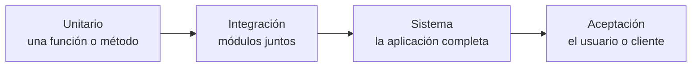

# Qué es testing y sus niveles

De las tres técnicas de aseguramiento de calidad (testing, análisis estático y code review), el **testing** es la única que ejecuta el programa. Esta nota define qué es un buen test y recorre los niveles en que se prueba una aplicación: desde una función aislada hasta el sistema completo en manos del cliente.

## Qué es testing

**Testing** es el proceso de ejecutar un programa **con el objetivo de encontrar errores**. De ahí sale una definición algo contraintuitiva: un buen test es el que tiene alta probabilidad de encontrar un error, y un test **exitoso** es el que descubre un error que no se conocía.

Beneficios:

- verificar que la funcionalidad cumple lo especificado;
- verificar que la implementación es robusta frente a errores posibles;
- dar una base sólida para seguir construyendo sin miedo a romper lo anterior;
- servir como **documentación** ejecutable de cómo se usa el código.

## Verificación y validación

| | **Verificación** | **Validación** |
|---|---|---|
| Pregunta | ¿Estamos construyendo el producto **correctamente**? | ¿Construimos el producto **correcto**? |
| Qué evalúa | Que el producto cumple las especificaciones y requisitos | Que satisface las necesidades reales de los usuarios |
| Cuándo | Primero, durante el desarrollo | Al final |

Un programa puede pasar toda la verificación (hace exactamente lo especificado) y fallar la validación (la especificación no era lo que el usuario necesitaba).

## Los niveles de testing

| Nivel | Qué se prueba | Ejemplo en una app web |
|---|---|---|
| **Unitario** | Una unidad aislada: función, procedimiento, módulo u objeto | La función `add`, un método simple de una clase |
| **Integración** | Varios módulos como conjunto | Un método que hace una request HTTP; un componente que pide datos |
| **Sistema** | El producto completo, de punta a punta | Una ruta que genera una respuesta; el flujo de navegación de un usuario |
| **Aceptación** | El cumplimiento frente al cliente | Usuarios finales aprueban el software antes de pasarlo a producción |

- **Unitarios**: validan que cada unidad haga lo que se espera. Se pueden escribir antes, durante o después de programar, pero exigen tener claros los inputs y los outputs esperados.
- **Integración**: aunque cada componente pase sus pruebas, falta verificar que interactúen bien entre sí; estos tests exponen los defectos en esa integración.
- **Sistema**: evalúan las especificaciones de forma *end-to-end*, normalmente conectados a otras piezas de software o hardware, antes de pasar a producción.
- **Aceptación**: los hacen usuarios finales o clientes, solo al final, cuando todo lo anterior ya pasó.

> [!tip] La pirámide de tests
> Conviene tener muchos tests unitarios (rápidos y baratos), menos de integración y pocos de sistema (lentos y frágiles). Un error detectado en un test unitario es mucho más fácil de ubicar que uno detectado al final.

## Test Driven Development

**TDD** es una metodología que desarrolla el código en ciclos pequeños e iterativos:

1. **Diseñar** un test para un requerimiento; al principio falla, porque el código no existe.
2. **Escribir** el código mínimo para que el test pase.
3. **Mejorar** la implementación (*refactor*), con el test como red de seguridad.

> [!warning] Que los tests pasen no prueba que no haya errores
> Los tests solo revisan los casos que alguien pensó. Un conjunto de tests en verde dice que esos casos funcionan, no que el programa sea correcto.

El testing visto en Ingeniería de Software, con Rails y Minitest, está en [[01 - Qué es el testing de software|Qué es el testing de software]] y [[03 - Niveles de testing en Rails|Niveles de testing en Rails]].

## Preguntas de repaso

> [!question]- ¿Por qué se dice que un test exitoso es el que encuentra un error?
> Porque el objetivo del testing es descubrir errores. Un test que solo confirma lo que ya funciona aporta poco; uno que revela un error desconocido entrega información nueva.

> [!question]- ¿Qué diferencia hay entre verificación y validación?
> La verificación comprueba que el producto cumple su especificación ("construirlo bien"). La validación comprueba que esa especificación responde a lo que el usuario realmente necesita ("construir lo correcto").

> [!question]- ¿Qué detecta un test de integración que los unitarios no?
> Los problemas en la interacción entre módulos: formatos incompatibles, supuestos distintos o llamadas mal encadenadas, aunque cada módulo funcione bien por separado.
