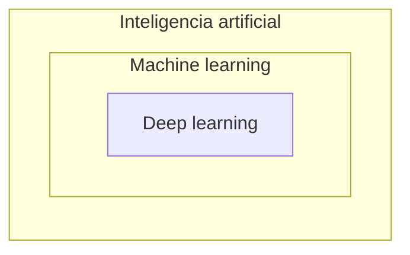

# IA, ML, DL y modelos de lenguaje

A la pregunta "¿cómo desarrollar más rápido?", hoy muchos responden "con una IA". Para usar bien esas herramientas, y saber cuándo desconfiar de ellas, hay que entender qué son: un modelo de lenguaje no "sabe" programar, sino que predice texto. Esta nota ordena los términos (IA, ML, DL) y explica cómo funciona un LLM y dónde están sus límites.

## IA, ML y DL

Son tres conceptos anidados, cada uno dentro del anterior:

| Concepto | Qué es | Ejemplos |
|---|---|---|
| **Inteligencia artificial** (IA) | El campo que usa computación y datos para resolver problemas con máquinas | Programas que juegan ajedrez, algoritmos de búsqueda, lógica condicional, predicción de estructuras tridimensionales |
| **Machine learning** (ML) | Sistemas que **aprenden y se adaptan** a partir de la experiencia, sin ser programados explícitamente | Sistemas de recomendación, predicción a partir de sensores, clustering |
| **Deep learning** (DL) | Técnica de ML que construye **capas** de unidades de procesamiento (neuronas) en una **red neuronal** artificial | Detección de objetos, segmentación de imágenes, vehículos autónomos, chatbots |

## Modelos de lenguaje

Un **LLM** (*large language model*) es un programa de IA que reconoce y genera texto parecido al que escribiría una persona. Se entrena con enormes cantidades de ejemplos de texto, comúnmente recolectado de internet, hasta poder interpretar el lenguaje humano y otros datos complejos. Se construye con machine learning, sobre una arquitectura especializada en lenguaje llamada **transformer**.

## Cómo funcionan: predecir la siguiente palabra

Todos los modelos de lenguaje siguen la misma idea: **dada una frase, aprender la distribución de probabilidades de las palabras siguientes**. Es lo que hace el teclado del celular, que después de "I had such a" sugiere "great", "great time" o "lovely", pero a una escala enorme.

> [!example]- Transcripción de la imagen
> Un bloque **LLM** recibe como *Input* los tokens `recite`, `the`, `first`, `law` y `$`, y produce un *Output* (una fila de casillas) con la predicción del siguiente token.

Para generar un texto largo se repite un ciclo:

1. Predecir la distribución de la siguiente palabra (o *token*).
2. Elegir una según esa distribución.
3. Agregarla al contexto.
4. Volver a predecir.

## Qué pueden hacer

Al aumentar el tamaño (la cantidad de parámetros) y los datos de entrenamiento, los modelos logran entender contexto, seguir instrucciones y generar textos extensos. Como permiten interactuar con lenguaje natural, bajan la barrera para trabajar con datos y ofrecer funcionalidades complejas:

- asistentes virtuales y creación de contenido;
- traducción;
- análisis de texto y extracción de información;
- **generación de código**.

## Sus límites

> [!warning] Un LLM no contiene conocimiento real
> Por su naturaleza, el modelo emite texto que busca ser **coherente** y parecer escrito por una persona, no texto **verdadero**. Puede inventar funciones, librerías o datos con total seguridad (*alucinaciones*). Además, su conocimiento se congela en la fecha de entrenamiento y no sabe nada del código privado de un proyecto.

## RAG: darle información al modelo

Para que el modelo responda con datos actualizados o propios (documentación interna, el código del proyecto), se usa **generación aumentada por recuperación** (*Retrieval-Augmented Generation*, RAG):

> [!example]- Transcripción de la imagen
> 1. El usuario envía *prompt + query*. 2. La aplicación usa la consulta para buscar información relevante en las *knowledge sources* (documentos y bases de datos). 3. Recibe la información relevante como contexto adicional. 4. Envía *prompt + query + enhanced context* al endpoint del LLM. 5. Recibe la respuesta generada.

El modelo no aprende nada nuevo: se le entrega la información relevante dentro del prompt, y genera la respuesta a partir de ella. Muchas veces la búsqueda se hace con una base de datos vectorial.

> [!tip] Tres formas de adaptar un modelo
> De menor a mayor esfuerzo: mejorar el **prompt** (*prompt engineering*), darle conocimiento externo con **RAG**, o reentrenarlo parcialmente con datos propios (***fine-tuning***).

## Preguntas de repaso

> [!question]- ¿Qué relación hay entre IA, ML y DL?
> Están anidados: el deep learning es una técnica de machine learning (con redes neuronales de varias capas), y el machine learning es una rama de la inteligencia artificial.

> [!question]- ¿Por qué un LLM puede "alucinar" una función que no existe?
> Porque genera el texto más probable dado el contexto, no el verdadero. Si el nombre de una función suena plausible, el modelo puede producirlo aunque nunca haya existido.

> [!question]- ¿Qué resuelve RAG y por qué no requiere reentrenar el modelo?
> Le da al modelo información que no conoce (actualizada o privada) buscándola en fuentes externas e incluyéndola en el prompt. El modelo no cambia: solo recibe más contexto en cada consulta.
