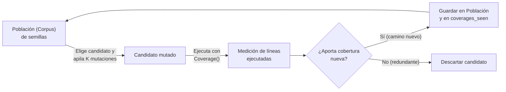

# Fuzzing por mutación guiado por cobertura

## Del fuzzer ciego al *Greybox Fuzzing*

El `MutationFuzzer` básico que construimos en la nota anterior tiene una limitación importante: **muta a ciegas**. Aunque una mutación logre descubrir por casualidad una rama nueva y profunda del programa (por ejemplo, cambiar `"?id=10"` por `"?id=0"` en `validate_url`), en la siguiente iteración el fuzzer la olvida y vuelve a mutar desde la semilla original.

La idea revolucionaria que dio origen a los *fuzzers* modernos de caja gris (**greybox fuzzers**, como **AFL** —*American Fuzzy Lop*— o *libFuzzer*) consiste en **combinar el fuzzing por mutación con la medición dinámica de cobertura (`Coverage`) del Tema 03**:



---

## Implementación de `MutationCoverageFuzzer`

Para guiar las mutaciones con cobertura, extendemos `MutationFuzzer` manteniendo dos estructuras clave:
1. **`self.population` (el *corpus* evolutivo):** la lista de entradas valiosas desde las cuales `create_candidate()` elige qué mutar.
2. **`self.coverages_seen`:** un conjunto de coberturas ya observadas (usando `frozenset` para poder guardar conjuntos dentro de un `set`), o bien el conjunto acumulado de líneas cubiertas hasta el momento.

```python
class MutationCoverageFuzzer(MutationFuzzer):
    def reset(self):
        super().reset()
        self.coverages_seen = set()
        self.population = []  # Se poblará con entradas que abran caminos nuevos

    def run(self, runner):
        result, outcome = super().run(runner)
        new_coverage = frozenset(runner.coverage())
        # Si la entrada pasó (o exploró una huella de líneas nunca antes vista), la conservamos
        if new_coverage not in self.coverages_seen:
            self.population.append(self.inp)
            self.coverages_seen.add(new_coverage)
        return result
```

### Resultado sobre `validate_url`

Recordemos que `RandomFuzzer` en $100$ intentos sobre `validate_url` lograba **$0$ líneas internas cubiertas**. Al correr $100$ iteraciones de fuzzing por mutación guiado por cobertura partiendo de la única semilla `"https://example.com/api/users?id=10"`, el fuzzer descarta $94$ mutaciones redundantes y conserva automáticamente un **corpus de solo $6$ entradas**:

* `"https://example.com/api/users?id=10"` (semilla original: cubre el camino completo válido).
* `"ht9ps>//example.com/api/users?id=10"` (mutó el esquema: cubre `return "invalid scheme"`).
* `"https:?examphe.com/api/users?id=10w"` (rompió el `//`: cubre `return "missing domain"`).
* `"https://~exampe.c1om/api-uarsid*=10C"` (rompió el prefijo `/api/`: cubre `return "invalid API path"`).
* `"https://eamplecom/api/users?id=0"` (quitó el `.` del dominio o dejó `id=0`: cubre las guardas de dominio e identificador no positivo).
* `"https://examplt.com/api/users?i`=10"` (mutó el nombre del parámetro `id`: cubre `return "missing id"`).

Con solo $6$ candidatos conservados de $100$ intentos, la suite alcanza las **$17$ líneas ejecutables de `validate_url` ($100\%$ de cobertura)** sin que hayamos escrito un solo caso de error a mano.

---

## Comparación y límites del fuzzing por mutación

| Dimensión | Random Fuzzing | Mutation-Based Fuzzing (con cobertura) |
| :--- | :--- | :--- |
| **Punto de partida** | Ninguno (genera desde la nada). | Requiere al menos una semilla (*seed*) válida. |
| **Entradas estructuradas** | Fracasa en el primer chequeo del parser. | Mantiene la estructura global y explora bordes vecinos. |
| **Crecimiento de cobertura** | Muy lento o nulo en formatos estrictos. | Rápido: cada hallazgo se suma a `population` para seguir mutando desde ahí. |

### Cuatro limitaciones que motivan los siguientes temas del curso

1. **Dependencia total de la calidad de la semilla:** si la semilla inicial es pobre o lejana a ciertas funcionalidades (por ejemplo, si ninguna semilla usa el protocolo `"https"`), la mutación tardará muchísimo en descubrir esas zonas.
2. **Las mutaciones a nivel de carácter son ciegas a la gramática:** borrar o voltear caracteres al azar funciona en URLs cortas, pero en formatos altamente anidados (como archivos JSON complejos o código fuente Python) casi siempre rompe el balance de paréntesis o comillas.
3. **Ineficiencia ante comparaciones exactas (*magic values*):** para entrar a una condición como `if x == 2 * (y + 1):` o `if pin == "0000":`, saber únicamente «qué líneas se ejecutaron» es un criterio binario (o entraste o no entraste). No nos dice *qué tan cerca* estuvimos de cumplir la igualdad. Ese problema lo resolveremos en el **Tema 05 (Fuzzing basado en búsqueda)** y en el **Tema 11 (Ejecución simbólica y concólica)**.
4. **El problema del oráculo persiste:** el fuzzer descubre entradas que recorren todos los caminos, pero si una rama devuelve un string equivocado sin lanzar una excepción, necesitamos un oráculo de negocio para notarlo.

---

---

## Ejemplo práctico: un mini fuzzer guiado por cobertura sobre `validar_pin`

```python
def validar_pin(pin):
    if len(pin) != 4:
        return "largo inválido"
    if not pin.isdigit():
        return "solo dígitos"
    if pin == pin[0] * 4:
        return "pin débil"
    return "ok"
```

Implementamos las ideas de la nota en unas pocas líneas: medimos las líneas ejecutadas con `sys.settrace` y solo conservamos los candidatos que aportan una huella nueva.

```python
import random, sys

def lineas(func, entrada):
    vistas = set()
    def tracer(frame, event, arg):
        if event == "line" and frame.f_code.co_name == func.__name__:
            vistas.add(frame.f_lineno)
        return tracer
    sys.settrace(tracer)
    try:
        func(entrada)
    finally:
        sys.settrace(None)
    return frozenset(vistas)

poblacion = ["1234"]
vistas = {lineas(validar_pin, "1234")}

for i in range(200):
    candidato = random.choice(poblacion)
    for _ in range(random.randint(1, 3)):
        candidato = mutate(candidato)
    huella = lineas(validar_pin, candidato)
    if huella not in vistas:                      # camino nuevo → conservar
        vistas.add(huella)
        poblacion.append(candidato)
        print(i, repr(candidato), validar_pin(candidato))
```

Una corrida típica imprime:

```
0 ')1234' largo inválido
2 '>123' solo dígitos
```

y termina con `poblacion = ['1234', ')1234', '>123']`:

* La semilla `"1234"` cubre el camino completo (hasta `"ok"`).
* `')1234'` abre la rama del largo inválido.
* `'>123'` mantiene el largo $4$ pero rompe `isdigit()`, abriendo la rama `"solo dígitos"`.

**Pero el fuzzer nunca encuentra `"pin débil"`**, aun con $200$ intentos. Para llegar ahí se necesitan cuatro dígitos *iguales*, una comparación exacta que a nivel de «líneas ejecutadas» no ofrece ninguna pista intermedia. Es el límite de los *magic values* de la nota: la cobertura de líneas es binaria, no distingue un candidato «casi igual» de uno totalmente distinto.

---

## Preguntas de repaso

> [!question]- ¿Qué ventaja fundamental aporta conservar en `self.population` las entradas mutadas que descubren cobertura nueva, en lugar de mutar siempre únicamente la semilla original?
> Permite una **exploración incremental paso a paso**: si una primera mutación logra atravesar una guarda difícil, al guardar ese candidato en `self.population` las siguientes mutaciones podrán partir desde ese nuevo estado intermedio y explorar las ramas anidadas más profundas, en lugar de tener que acertar todas las mutaciones necesarias en un solo intento desde la semilla inicial.

> [!question]- Queremos probar el parser `http_program(url)` (que exige esquema `"http"` o `"https"` y `netloc` no vacío) y nos proponen tres semillas iniciales: $S_1 = \text{"hola"}$, $S_2 = \text{"http://"}$ y $S_3 = \text{"http://uc.cl/cursos"}$. Ordena las semillas de peor a mejor y justifica por qué.
> El orden de peor a mejor es **$S_1 < S_2 < S_3$**:
> * $S_1$ (`"hola"`) es inválida desde el inicio; necesitaría múltiples inserciones exactas improbables solo para formar `"http://"`.
> * $S_2$ (`"http://"`) ya tiene el esquema válido, pero su `netloc` está vacío; solo las mutaciones que inserten caracteres al final lograrán volverla válida.
> * $S_3$ (`"http://uc.cl/cursos"`) ya es una URL completamente válida con margen en su ruta: la gran mayoría de sus mutaciones individuales seguirán siendo válidas mientras exploran bordes del esquema, del host y del *path*.

> [!question]- ¿Por qué `MutationCoverageFuzzer` sigue teniendo dificultades para cubrir una rama protegida por `if clave == "X9#kL2!p":` aunque registre la cobertura en cada intento?
> Porque la cobertura de líneas solo ofrece retroalimentación **cuando ya lograste entrar a la ramanueva**. Mientras `clave` difiera aunque sea en un carácter de `"X9#kL2!p"`, todas las mutaciones fallidas ejecutan exactamente la misma línea del `if` (rama falsa), por lo que ninguna aporta cobertura nueva ni le indica al fuzzer que tener $7$ de los $8$ caracteres correctos está «más cerca» que tener $0$.

> [!question]- En el mini fuzzer, ¿por qué se guarda `frozenset(vistas)` y no el `set` directamente en `vistas`?
> Porque los elementos de un `set` deben ser *hashables*, y un `set` normal no lo es (es mutable). `frozenset` es la versión inmutable y hashable, y permite guardar conjuntos de líneas dentro de otro conjunto y preguntar en $O(1)$ si esa huella ya se vio.

> [!question]- Propón un cambio mínimo a la semilla del mini fuzzer para que encuentre `"pin débil"` con facilidad.
> Agregar a la población inicial una semilla como `"1111"` (que ya es un pin débil) o `"1110"` (a un `flip` de distancia: `"1"` y `"0"` difieren en un solo bit). Con una semilla cercana a la condición exacta, una sola mutación basta. Es la ilustración de que la calidad de las semillas condiciona lo que puede descubrir un fuzzer de mutación.
