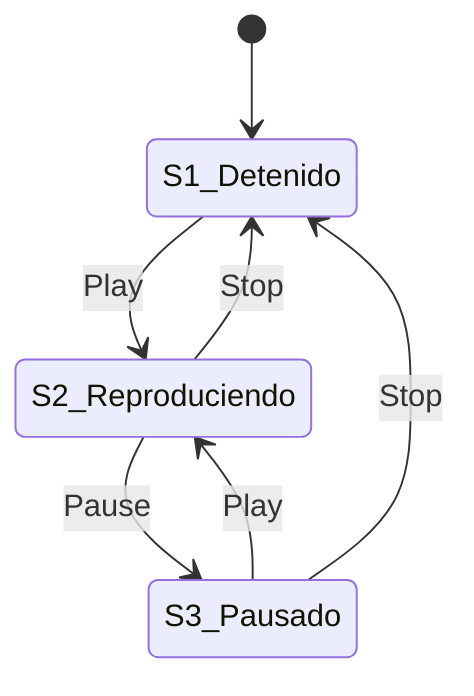

# Pruebas de transición de estados, cobertura 0-switch y 1-switch

## Cuando el historial importa: Máquinas de Estado Finito

En las tablas de decisión asumimos que el sistema no tiene memoria: ante las mismas entradas produce siempre la misma salida. Pero en muchos sistemas el resultado de una acción depende de **qué ocurrió antes**: presionar el botón `Pause` en un reproductor de música pausa la canción si estaba reproduciendo, pero no hace nada si el reproductor estaba detenido; ingresar un PIN erróneo en un cajero automático por primera vez pide reintentar, pero al tercer intento consecutivo traga la tarjeta.

Las **Pruebas de Transición de Estados** (*State Transition Testing*) modelan el sistema como una **máquina de estados finita** compuesta por cuatro elementos:
1. **Estados ($S$):** las situaciones discretas en que puede encontrarse el sistema (ej. `Detenido`, `Reproduciendo`, `Pausado`).
2. **Eventos ($E$):** los estímulos o entradas externas que recibe el sistema (ej. `Play`, `Pause`, `Stop`).
3. **Transiciones ($T$):** el cambio válido desde un estado origen a un estado destino disparado por un evento.
4. **Acciones:** el efecto o salida producida al ocurrir la transición.

---

## Diagrama de estados frente a Tabla de transición de estados

Usemos el problema clásico de interrogación (**Q13: Reproductor multimedia**) con $3$ estados (`S1 Detenido`, `S2 Reproduciendo`, `S3 Pausado`) y $3$ eventos (`Play`, `Pause`, `Stop`):

Mientras el **diagrama de estados** muestra visualmente las **$5$ transiciones válidas** (las flechas), la **tabla de transición de estados** cruza todos los estados contra todos los eventos ($3 \times 3 = 9$ celdas) para revelar también las **$4$ transiciones inválidas o nulas (`—`)**:

| Estado actual $\setminus$ Evento | `Play` | `Pause` | `Stop` |
| :--- | :---: | :---: | :---: |
| **`S1` — Detenido** | `S2` | `—` (sin efecto) | `—` (sin efecto) |
| **`S2` — Reproduciendo** | `—` (sin efecto) | `S3` | `S1` |
| **`S3` — Pausado** | `S2` | `—` (sin efecto) | `S1` |

> [!tip] ¿Cuándo debemos probar las celdas marcadas con `—` (transiciones inválidas)?
> Si el usuario o el entorno puede enviar físicamente el evento en ese estado (por ejemplo, presionar el botón físico de peatón mientras el semáforo está en amarillo, o pulsar `Stop` cuando el reproductor ya está `Detenido`), **debemos diseñar casos de prueba para esas celdas `—`** verificando que el sistema las ignore de forma segura sin caerse ni corromper su estado.

---

## Niveles de cobertura: *0-switch* y *1-switch coverage* (Chow)

### 1. Cobertura de transiciones simples (*0-switch coverage*)

Exige ejercitar **cada transición válida individual del diagrama al menos una vez** (es el mínimo recomendado para cualquier sistema). En el reproductor hay **$5$ transiciones válidas**:
* Si escribimos **un test independiente por transición**, necesitamos **$5$ casos de prueba**.
* Si encadenamos los eventos en **una sola secuencia continua** que recorra todas las flechas, basta **$1$ caso de prueba de $6$ pasos**:
  $$S_1 \xrightarrow{\text{Play}} S_2 \xrightarrow{\text{Pause}} S_3 \xrightarrow{\text{Play}} S_2 \xrightarrow{\text{Stop}} S_1 \xrightarrow{\text{Play}} S_2 \xrightarrow{\text{Pause}} S_3 \xrightarrow{\text{Stop}} S_1$$
  *(Nota: el tramo inicial $S_1 \to S_2$ se repite solo para poder salir de $S_1$ y alcanzar la última transición pendiente $S_3 \xrightarrow{\text{Stop}} S_1$).*

### 2. Cobertura de pares de transiciones (*1-switch coverage*)

En sistemas críticos, probar cada flecha aislada no basta: hay defectos que solo aparecen al ejecutar una secuencia específica de **dos transiciones válidas consecutivas** ($A \to B \to C$). A cubrir todos los pares de transiciones consecutivas válidas se le llama **1-switch coverage** (y cubrir tripletas consecutivas es *2-switch coverage*).

¿Cuántos pares válidos ($T_1$ seguida inmediatamente de $T_2$, donde el estado destino de $T_1$ es el estado origen de $T_2$) existen en el reproductor? Contémoslos sistemáticamente según el estado intermedio:

* **Pares que pasan por `S2`:**
  * Desde $S_1 \xrightarrow{\text{Play}} S_2$ podemos seguir con `Pause` o con `Stop` ($2$ pares: `#1: S1→S2→S3` y `#2: S1→S2→S1`).
  * Desde $S_3 \xrightarrow{\text{Play}} S_2$ podemos seguir con `Pause` o con `Stop` ($2$ pares: `#5: S3→S2→S3` y `#6: S3→S2→S1`).
* **Pares que pasan por `S3`:**
  * Desde $S_2 \xrightarrow{\text{Pause}} S_3$ podemos seguir con `Play` o con `Stop` ($2$ pares: `#3: S2→S3→S2` y `#4: S2→S3→S1`).
* **Pares que pasan por `S1`:**
  * Desde $S_2 \xrightarrow{\text{Stop}} S_1$ solo existe una salida válida desde $S_1$: `Play` ($1$ par: `#8: S2→S1→S2`).
  * Desde $S_3 \xrightarrow{\text{Stop}} S_1$ solo existe una salida válida desde $S_1$: `Play` ($1$ par: `#7: S3→S1→S2`).

En total existen exactamente **$2 + 2 + 2 + 1 + 1 = \mathbf{8}\text{ pares de transiciones válidas}$** ($8$ tests si se prueban por separado, o $1$ secuencia larga que recorra los $8$ pares).

---

## Preguntas de repaso

> [!question]- ¿Cuál es la diferencia entre alcanzar *100% de cobertura de estados* y alcanzar *100% de cobertura de transiciones (0-switch coverage)*?
> Visitar todos los estados (nodos del grafo) es mucho más débil que recorrer todas las transiciones (aristas del grafo). Por ejemplo, en el reproductor multimedia la secuencia corta $S_1 \xrightarrow{\text{Play}} S_2 \xrightarrow{\text{Pause}} S_3$ ya visita el $100\%$ de los estados ($S_1, S_2, S_3$), pero apenas ejercita $2$ de las $5$ transiciones válidas ($40\%$ de *0-switch coverage*), dejando sin probar qué hace el botón `Stop` ni cómo se reanuda desde `Pausado`.

> [!question]- En un semáforo con $3$ estados (`S1 Verde`, `S2 Amarillo`, `S3 Rojo`), el temporizador hace avanzar `S1 → S2 → S3 → S1`. Además, un botón peatonal en `S1` mantiene el estado en `S1` (self-loop `S1 → S1`) y en `S3` mantiene el estado en `S3` (self-loop `S3 → S3`). ¿Cuántas transiciones válidas (*0-switch*) y cuántos pares consecutivos válidos (*1-switch*) tiene el sistema?
> * **0-switch:** tiene **$5$ transiciones válidas** ($3$ por temporizador más $2$ *self-loops* por botón peatonal).
> * **1-switch:** considerando los pares simples (sin encadenar múltiples *self-loops* repetidos), existen **$6$ pares consecutivos**: `S1→S2→S3`, `S2→S3→S1`, `S3→S1→S2`, `S3→S1→S1`, `S1→S1→S2` y `S3→S3→S1`.

> [!question]- Al construir la tabla de transición de estados de un cajero automático (ATM), en la fila del estado `S6: Acceso a cuenta` aparecen signos de interrogación `?` bajo las columnas `PIN válido` y `PIN inválido`. ¿Qué representa ese `?` y por qué es valioso encontrarlo durante el diseño de pruebas?
> Representa una **ambigüedad u omisión en la especificación**: los requerimientos definieron cómo pedir el PIN antes de entrar a la cuenta, pero nunca especificaron si la pantalla o el teclado numérico permite volver a enviar un evento de PIN una vez que el cliente ya está dentro de `S6`. Descubrirlo al armar la matriz Estado $\times$ Evento permite corregir el diseño o crear pruebas de seguridad específicas.

