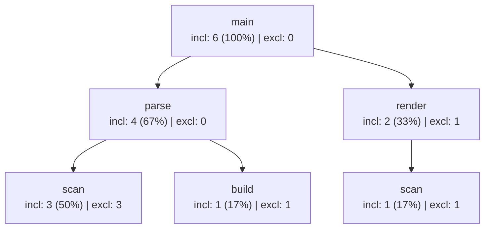

# Perfilado por muestreo Execution Sampling y Calling Context Tree

## La filosofía del muestreo: fotografiar la pila sin tocar el código

¿Cómo podemos perfilar un servidor en producción o un programa enorme sin modificar ni una sola línea de su código ni hacer que corra diez veces más lento? La respuesta es el **Execution Sampling** (perfilado por muestreo estadístico), utilizado por herramientas industriales como `py-spy`, `pyinstrument` o `Austin`.

En lugar de interceptar cada llamada a función, el *sampler* ejecuta el programa objetivo en un hilo de trabajo (`tid`) y lanza en paralelo un **hilo monitor** que duerme durante un intervalo $\Delta t$ (por ejemplo, $1\text{ ms}$ o $10\text{ ms}$). Cada vez que despierta, toma una **muestra** (*sample*): inspecciona la pila de llamadas actual del hilo trabajador usando `sys._current_frames()[tid]` y `traceback.walk_stack(frame)`.

```python
import sys, threading, time, traceback

class SimpleSampler:
    def __init__(self, target_tid, interval=0.01):
        self.tid = target_tid
        self.interval = interval
        self.active = False
        self.samples = []  # lista de pilas capturadas, p. ej. [['main', 'parse', 'scan'], ...]

    def check_trace(self):
        frame = sys._current_frames().get(self.tid)
        if frame is not None:
            stack = [f.f_code.co_name for f, _ in traceback.walk_stack(frame)]
            stack.reverse()  # orden desde la raíz ('main') hasta la función activa en el tope
            self.samples.append(stack)

    def run_loop(self):
        self.active = True
        while self.active:
            self.check_trace()
            time.sleep(self.interval)
```

---

## Del muestreo plano al Calling Context Tree (CCT)

Si solo contáramos qué función está en el tope de la pila en cada foto, sabríamos que `scan` consume mucho tiempo, pero no sabríamos **quién la llamó** cuando consumió ese tiempo (¿fue `parse` o fue `render`?).

Un **Calling Context Tree (CCT)** o *árbol de contextos de llamada* agrupa las pilas muestreadas por sus **prefijos compartidos** desde la raíz (`main`). A diferencia de un *Call Graph* plano (donde `scan` es un único nodo), en un CCT **cada ruta distinta de llamadores crea un nodo separado**: `main -> parse -> scan` es un nodo distinto de `main -> render -> scan`.

### Construcción paso a paso de un CCT (ejemplo de 6 muestras cada $10\text{ ms}$)

Supongamos que muestreamos un hilo durante $60\text{ ms}$ (en $t = 5, 15, 25, 35, 45, 55\text{ ms}$) y capturamos estas 6 pilas de llamadas:
- **S1 ($t=5\text{ ms}$)**: `main -> parse -> scan`
- **S2 ($t=15\text{ ms}$)**: `main -> parse -> scan`
- **S3 ($t=25\text{ ms}$)**: `main -> parse -> build`
- **S4 ($t=35\text{ ms}$)**: `main -> render -> scan`
- **S5 ($t=45\text{ ms}$)**: `main -> render` (aquí `render` ejecuta trabajo propio sin llamar a otra función)
- **S6 ($t=55\text{ ms}$)**: `main -> parse -> scan`

Al insertar estas 6 rutas en el CCT reutilizando prefijos comunes, cada nodo mantiene dos contadores clave:
1. **Contador inclusivo (*inclusive*)**: cuántas muestras contienen a este nodo en cualquier parte de la ruta (mide el tiempo gastado en la función **más** todos sus descendientes en ese contexto).
2. **Contador exclusivo (*exclusive*)**: cuántas muestras terminan **exactamente en este nodo** como último frame de la pila (mide el trabajo propio de la función, sin contar a sus hijos).



### Cómo leer el CCT resultante
- **`parse` tiene `incl: 4, excl: 0`**: estuvo activa en $4/6 \approx 67\%$ del tiempo total, pero su contador exclusivo es $0$ porque en esas 4 muestras el trabajo real de CPU estaba ocurriendo dentro de sus hijos (`scan` o `build`).
- **`render` tiene `incl: 2, excl: 1`**: estuvo en la pila en 2 muestras (S4 y S5); en S4 delegó en `scan`, pero en S5 era el último frame de la pila (trabajo propio).
- **Contexto diferenciado para `scan`**: en total `scan` aparece en $4/6$ muestras, pero el CCT nos revela que el **75% de su costo ($3/6$)** ocurre cuando la invoca `parse`, y solo $1/6$ cuando la invoca `render`. Si queremos optimizar las llamadas a `scan`, debemos investigar `parse`.

> [!tip] Conexión con `sampler.py` del curso
> En el proyecto `sampler/` del curso, `Sampler.manageStackTrace(stack)` compara la pila anterior (`self.calls`) con la nueva (`stack`) mediante `comparar_listas` (buscando el último índice coincidente del prefijo común): cierra los nodos que salieron de la pila (`killLastSon`, moviéndolos a `self.called`) y abre los nuevos (`createSon`), sumando $1\text{ tick}$ en cada intervalo a toda la rama activa (`self.node.tick()`).

---

## Preguntas de repaso

> [!question]- ¿Cuál es la diferencia estructural entre un Call Graph y un Calling Context Tree (CCT)?
> En un *Call Graph* cada función del programa es a lo sumo un único nodo (lo que mezcla las llamadas a una función utilitaria como `scan` sin importar desde qué cadena superior se llegó a ella). En un *Calling Context Tree (CCT)* cada nodo representa un **camino completo de llamada desde la raíz**, por lo que `main -> parse -> scan` y `main -> render -> scan` son dos nodos distintos con contadores independientes.

> [!question]- En un CCT construido con 100 muestras, un nodo `procesar` tiene contador inclusivo 60 y contador exclusivo 5. ¿Cómo debes interpretar esos números al buscar qué optimizar?
> Significa que `procesar` está presente en la pila durante el 60% del tiempo total del programa, pero solo el 5% del tiempo ejecuta instrucciones propias; el 55% restante del tiempo se gasta dentro de las funciones hijas que `procesar` invoca.

> [!question]- Si en la muestra S1 la pila es `main -> parse -> scan` y en la muestra S6 una **segunda invocación distinta** a `parse` vuelve a tener la pila `main -> parse -> scan`, ¿el CCT estándar crea otro nodo `parse` o acumula sobre la misma ruta?
> El CCT agregado estándar reutiliza la ruta `main -> parse -> scan` y suma al mismo nodo (pasando de 2 a 3), porque agrupa por contexto de llamada (prefijo de nombres de función), sin conservar el orden cronológico de invocaciones separadas.
