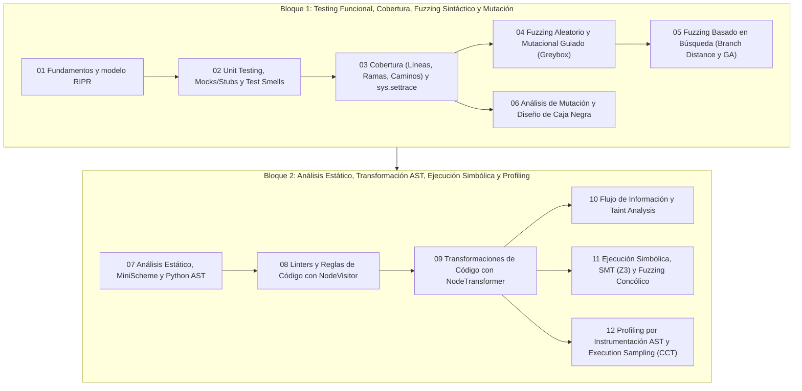

# Síntesis de evaluaciones y guía de estudio para interrogaciones y examen

## Mapa estratégico del curso

El curso se articula en dos grandes bloques conceptuales que conectan la verificación funcional clásica con el análisis automático de programas:

---

## Hoja de ruta para la Primera Interrogación (Temas 01 al 06)

Las preguntas de evaluación del primer bloque combinan **cálculo de métricas paso a paso**, **diseño sistemático de casos** e **implementación en Python**:

| Tema | Conceptos y habilidades clave que debes dominar |
| :--- | :--- |
| **01. Fundamentos** | Diferenciar error humano (*mistake*), defecto (*fault/bug*) y falla (*failure*); aplicar las 4 condiciones del **modelo RIPR** (*Reachability, Infection, Propagation, Revealability*) para explicar por qué un bug ejecutado no siempre hace fallar un test; pirámide de Cohn, cuadrantes de Marick y el problema del oráculo. |
| **02. Unit Testing y Smells** | Estructura AAA (*Arrange-Act-Assert*), principios FIRST, cuándo usar un **Stub** (controlar entradas indirectas/estado) frente a un **Mock** (verificar salidas indirectas/interacciones con `unittest.mock`), e identificar/refactorizar *Test Smells* (*Assertion Roulette*, *Eager Test*, *Mystery Guest*, *Conditional Test Logic*). |
| **03. Cobertura y `settrace`** | Construir el **CFG** de una función, demostrar con contraejemplos por qué **Cobertura de Ramas $\implies$ Cobertura de Líneas** pero no al revés, explicar por qué un `if` sin `else` exige 2 casos de prueba para cubrir ambas ramas, e implementar un colector de líneas y ramas con `sys.settrace`. |
| **04. Fuzzing Sintáctico** | Calcular la probabilidad de que un fuzzer aleatorio supere condiciones estrechas (como `s == "magic"`), implementar los mutadores `delete_random_character`, `insert_random_character` y `flip_random_character`, y explicar cómo el bucle de ` GreyboxFuzzer` usa la cobertura como *feedback* para poblar la *seed queue*. |
| **05. Search-Based Fuzzing** | Calcular la **distancia de rama (*branch distance*)** para operadores relacionales ($==, \neq, <, \le, >, \ge$), explicar cómo un paisaje plano (*plateau*) frena a *Hill Climbing*, cómo se estanca en óptimos locales y cómo el algoritmo genético combina selección por torneo, *crossover* y mutación. |
| **06. Mutación y Caja Negra** | Calcular el **Mutation Score** descontando **mutantes equivalentes**, distinguir mutantes triviales vs. difíciles de matar, e instrumentar mutantes o tests con **Particiones de Equivalencia (EP)**, **Valores Límite (BVA)**, **Tablas de Decisión** y **Transición de Estados**. |

---

## Hoja de ruta para la Segunda Interrogación y Examen (Temas 07 al 12)

El segundo bloque evalúa con especial profundidad la capacidad de **leer, diseñar y depurar visitantes y transformadores de AST**, además de **trazar ejecución simbólica/concólica y perfilado**:

1. **Árboles de Sintaxis Abstracta (`MiniScheme` y `ast` de Python) — [[07-Análisis estático y árboles de sintaxis abstracta/_Índice|Tema 07]]**:
   - Saber escribir un intérprete recursivo con `match/case` sobre S-expressions y distinguir las 4 categorías del AST de Python (`mod`, `stmt`, `expr`, `expr_context`: `Load`, `Store`, `Del`).
   - Recordar por qué `a < b < c` se representa como un único nodo `ast.Compare` con `ops=[Lt(), Lt()]` y `comparators=[b, c]`.
2. **Reglas de linter con `NodeVisitor` — [[08-Reglas de código automáticas y linters/_Índice|Tema 08]]**:
   - Implementar reglas con estado contextual (contadores de `assert`, banderas `in_loop` que se restauran al salir, o `scope_stack` de diccionarios para detectar variables no usadas respetando el *shadowing* entre funciones).
   - No olvidar jamás llamar a `self.generic_visit(node)` para no truncar la exploración de subárboles.
3. **Transformaciones con `NodeTransformer` — [[09-Transformaciones de código con AST/_Índice|Tema 09]]**:
   - Dominar el contrato de retorno de `visit_*`: devolver `node` (conservar), `None` (eliminar) o un nodo nuevo (reemplazar), e invocar siempre `ast.fix_missing_locations(tree)` antes de `compile()`.
   - Explicar la trampa de `RenameTransformer` (renombrar `ast.Name` pero olvidar el string `node.name` en `FunctionDef` y `arg.arg` en `arguments`).
   - Implementar inyecciones y limpiezas en dos pasadas (como eliminar código muerto tras `return` o envolver sentencias para medir cobertura).
4. **Flujo de información y *Taint Analysis* — [[10-Análisis de flujo de información y taint analysis/_Índice|Tema 10]]**:
   - Distinguir **Fuentes (*Sources*)**, **Sumideros (*Sinks*)** y **Sanitizadores**, rastrear flujos explícitos (asignación/concatenación) frente a **flujos implícitos** (variables asignadas dentro de ramas `if` cuya condición está contaminada), y explicar cómo funciona la clase `tstr` guardando el origen del *taint*.
5. **Ejecución Simbólica, Z3 y Fuzzing Concólico — [[11-Ejecución simbólica y fuzzing concólico/_Índice|Tema 11]]**:
   - Construir a mano el árbol de ejecución simbólica y las **condiciones de camino ($PC$)** de una función con ramas y ciclos, formular las restricciones en `z3-solver` (`Int`, `Solver`, `sat`/`unsat`, `model()`), y ejecutar paso a paso el algoritmo concólico negando un predicado del camino actual ($\pi_1 \land \dots \land \neg \pi_k$) para descubrir la siguiente entrada concreta.
   - Analizar la explosión de caminos en bucles y cómo mitigarla (cota de profundidad $K$, heurísticas de búsqueda o *loop summarization*), además de por qué una función hash criptográfica o llamada externa rompe la ejecución simbólica pura y cómo el enfoque concólico la sortea concretizando valores.
6. **Profiling por Instrumentación y *Execution Sampling* — [[12-Análisis dinámico y perfilado de ejecución/_Índice|Tema 12]]**:
   - Implementar `FunctionInstrumentor` envolviendo `return expr` como `return Profiler.record_end(_profiler_start_data, expr)` y explicar cómo `_profiler_start_data` (o una pila LIFO de tiempos) permite medir funciones recursivas sin pisar el tiempo del padre.
   - Construir un **Calling Context Tree (CCT)** a partir de muestras de pila (`sys._current_frames()`), calcular contadores **inclusivos** y **exclusivos**, y justificar el **Efecto del Observador** (sobrecarga en funciones cortas llamadas muchas veces) y el **sesgo de período constante $K$** (corregido mediante *jitter* aleatorio).

---

## Preguntas de repaso

> [!question]- ¿Qué tienen en común la instrumentación de cobertura del Tema 09, el rastreo concólico del Tema 11 y el perfilador por instrumentación del Tema 12?
> Los tres utilizan exactamente la misma técnica estructural: reescribir el código fuente o su comportamiento mediante el AST (`ast.NodeTransformer`) o clases envoltorio (*proxies* como `zint`/`tstr`) para inyectar sensores que observan la ejecución real sin cambiar el valor de retorno observable de las funciones.

> [!question]- Si en una pregunta de prueba te piden elegir entre Fuzzing Basado en Búsqueda (Tema 05) y Ejecución Simbólica/Concólica (Tema 11) para atravesar una validación `if x * x + 3 * x == 40:`, ¿cuál eliges y qué pasa si la validación cambia a `if sha256(x) == H:`?
> Para `x * x + 3 * x == 40`, tanto Search-Based Fuzzing (usando la distancia de rama $|x^2 + 3x - 40|$) como Z3 la resuelven instantáneamente, siendo Z3 directo en un solo paso algebraico. En cambio, para `sha256(x) == H`, ambos fracasan en invertir el hash: para Z3 es una restricción no invertible (*caja negra*) y para Search-Based Fuzzing el paisaje de fitness es completamente aleatorio (efecto avalancha), por lo que en un test unitario se debe usar un **Stub/Mock** (Tema 02) o concretizar la llamada en ejecución concólica.

> [!question]- Antes de entregar cualquier pregunta de código que implemente un `ast.NodeVisitor` o un `ast.NodeTransformer` en una prueba escrita, ¿cuáles son las 3 verificaciones obligatorias que debes revisar en tu respuesta?
> 1) Haber llamado a `self.generic_visit(node)` para no dejar subárboles sin visitar; 2) en `NodeTransformer`, haber retornado explícitamente `node` (o el nuevo nodo) en cada método `visit_*` para no borrar el subárbol devolviendo `None` por accidente; y 3) haber ejecutado `ast.fix_missing_locations(tree)` sobre el árbol transformado antes de compilarlo o desparsearlo.

