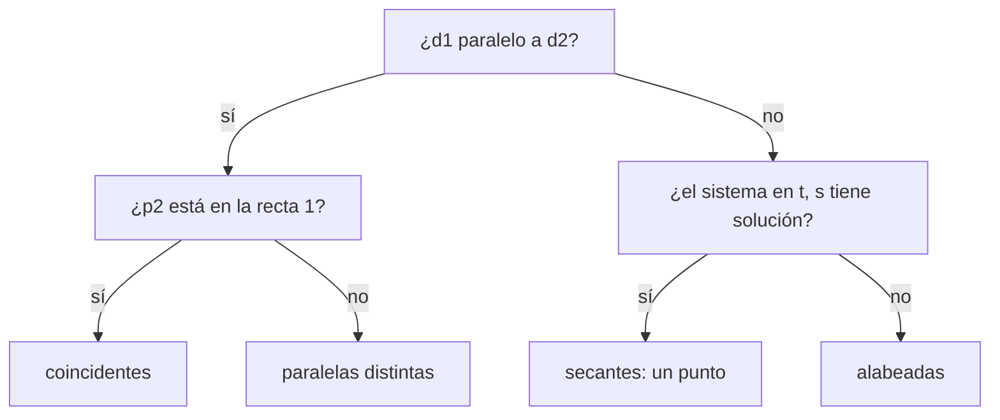

# Posición relativa, intersecciones e hiperplanos

Una vez que rectas y planos se escriben con vectores, las preguntas geométricas ("¿se cortan?, ¿son paralelos?, ¿dónde se cruzan?") se responden comparando normales y directores y resolviendo pequeños sistemas de ecuaciones. Esta nota reúne esos criterios y los generaliza a $\mathbb{R}^n$, donde una ecuación lineal describe un **hiperplano**. Es la motivación geométrica directa de los sistemas de ecuaciones lineales.

## Dos planos

> [!tip] Posición relativa de dos planos
> Dos planos son **paralelos** si y solo si sus normales son paralelos. Si además comparten un punto, son el mismo plano. Si los normales no son paralelos, se cortan en una **recta** con director $\mathbf n_1 \times \mathbf n_2$.

El **ángulo entre dos planos** se define como el ángulo entre sus normales. Dos planos son perpendiculares si $\mathbf n_1 \cdot \mathbf n_2 = 0$.

**Ejemplo.** Recta de intersección de $\pi_1: x + y + z = 1$ y $\pi_2: x + 2y + 2z = 1$.

- Director: $\mathbf n_1 \times \mathbf n_2 = \langle 1, 1, 1\rangle \times \langle 1, 2, 2\rangle = \langle 0, -1, 1\rangle$.
- Un punto común: restando las ecuaciones, $y + z = 0$; con $z = 0$ queda $y = 0$ y $x = 1$, así que $(1, 0, 0)$ está en ambos.

La recta es $\mathbf x = \langle 1, 0, 0\rangle + t\langle 0, -1, 1\rangle$. Otra forma, sin producto cruz, es resolver el sistema de dos ecuaciones dejando una variable libre como parámetro; es lo que se generaliza en el capítulo de sistemas.

## Recta y plano

Sea la recta $\mathbf x = \mathbf p + t\mathbf d$ y el plano $\mathbf n \cdot \mathbf x = d$.

| Condición | Posición |
|---|---|
| $\mathbf n \cdot \mathbf d \neq 0$ | se cortan en **un punto** |
| $\mathbf n \cdot \mathbf d = 0$ y $\mathbf n \cdot \mathbf p = d$ | la recta está **contenida** en el plano |
| $\mathbf n \cdot \mathbf d = 0$ y $\mathbf n \cdot \mathbf p \neq d$ | la recta es **paralela** al plano y no lo toca |

Para hallar el punto se reemplazan las paramétricas de la recta en la ecuación del plano, lo que deja una ecuación en $t$.

**Ejemplo.** La recta por $P(2, 4, 6)$ perpendicular al plano $x - y + 3z = 7$ usa como director el normal: $\mathbf x = \langle 2 + t, 4 - t, 6 + 3t\rangle$. Reemplazando, $(2 + t) - (4 - t) + 3(6 + 3t) = 7$, o sea $16 + 11t = 7$ y $t = -\tfrac{9}{11}$. El punto de corte es $\left(\tfrac{13}{11}, \tfrac{53}{11}, \tfrac{39}{11}\right)$, el **punto del plano más cercano a $P$**.

La distancia de $P$ al plano es la longitud del tramo recorrido, $|t|\,\|\mathbf n\| = \tfrac{9}{11}\sqrt{11} = \tfrac{9}{\sqrt{11}}$. En general:

$$
d(Q, \pi) = \frac{|\mathbf n \cdot \mathbf q - d|}{\|\mathbf n\|}.
$$

## Dos rectas en el espacio

Se igualan las formas vectoriales con parámetros distintos, $\mathbf p_1 + t\mathbf d_1 = \mathbf p_2 + s\mathbf d_2$, que es un sistema de tres ecuaciones con dos incógnitas.

Dos rectas están en un mismo plano exactamente cuando son paralelas o secantes. En ese caso el plano que las contiene tiene normal $\mathbf d_1 \times \mathbf d_2$ si son secantes, o $\mathbf d_1 \times \overrightarrow{P_1P_2}$ si son paralelas (los directores no bastan, porque son paralelos entre sí).

## Hiperplanos y conteo de dimensiones

Una ecuación lineal $a_1x_1 + \dots + a_nx_n = b$, o sea $\mathbf n \cdot \mathbf x = b$ con $\mathbf n \neq \mathbf 0$, describe en $\mathbb{R}^2$ una recta, en $\mathbb{R}^3$ un plano y en $\mathbb{R}^n$ un **hiperplano**. Cada ecuación independiente "consume" una dimensión, y cada parámetro libre "aporta" una:

> [!tip] Regla de conteo (caso típico)
> $$\text{n.º de parámetros} + \text{n.º de ecuaciones} = n .$$
> En $\mathbb{R}^3$: una ecuación y dos parámetros dan un plano; dos ecuaciones y un parámetro, una recta; tres ecuaciones, un punto.

Vale cuando las ecuaciones son "independientes"; si dos planos son paralelos o coinciden, la regla falla. Precisar qué significa "independiente" es justamente el objetivo de los capítulos siguientes.

| Objeto | Forma vectorial | Ecuaciones |
|---|---|---|
| Recta en $\mathbb{R}^2$ | $\mathbf x = \mathbf p + t\mathbf d$ | $ax + by = c$ (normal $\langle a, b\rangle$) |
| Recta en $\mathbb{R}^3$ | $\mathbf x = \mathbf p + t\mathbf d$ | dos ecuaciones lineales (dos planos) |
| Plano en $\mathbb{R}^3$ | $\mathbf x = \mathbf p + s\mathbf u + t\mathbf v$ | $ax + by + cz = d$ (normal $\langle a, b, c\rangle$) |
| Hiperplano en $\mathbb{R}^n$ | $n - 1$ parámetros | $\mathbf n \cdot \mathbf x = b$ |

## Preguntas de repaso

> [!question]- ¿Son paralelos los planos $2x - y + 4z = 1$ y $-4x + 2y - 8z = 3$? ¿Son el mismo plano?
> Son paralelos, porque los normales cumplen $\langle -4, 2, -8\rangle = -2\langle 2, -1, 4\rangle$. No son el mismo: multiplicando la primera ecuación por $-2$ se obtiene $\dots = -2$, distinto de $3$.

> [!question]- Dé la ecuación del plano que pasa por $(1, 2, 3)$ y contiene a la recta $x = 3t$, $y = 1 + t$, $z = 2 - t$.
> Un punto de la recta es $(0, 1, 2)$. Los directores son $\langle 3, 1, -1\rangle$ y $\langle 1, 1, 1\rangle$ (de $(0, 1, 2)$ a $(1, 2, 3)$). Su producto cruz es $\langle 2, -4, 2\rangle \propto \langle 1, -2, 1\rangle$, así que el plano es $x - 2y + z = 0$.

> [!question]- ¿Por qué el ángulo entre dos planos se define con los normales y no con los directores?
> Porque cada plano tiene infinitos pares de directores y el ángulo entre ellos depende de cuáles se elijan. El normal es único salvo múltiplos y determina por completo la inclinación del plano.

> [!question]- En $\mathbb{R}^4$, ¿qué objeto describe un sistema de dos ecuaciones lineales "independientes"?
> Por la regla de conteo, $4 - 2 = 2$ parámetros libres: un plano dentro de $\mathbb{R}^4$.

> [!question]- Si $\mathbf n \cdot \mathbf d = 0$, ¿qué puede pasar entre la recta y el plano? ¿Cómo se decide?
> La recta es paralela al plano: o está contenida en él o no lo toca. Se decide probando un punto de la recta en la ecuación del plano.
