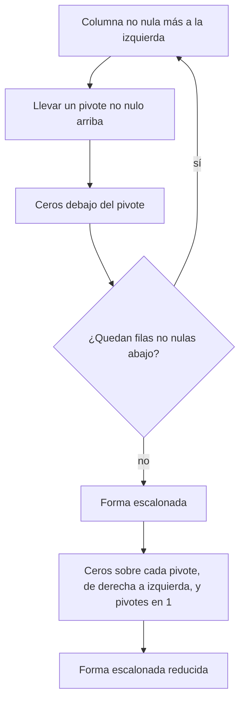

# Algoritmo de reducción por filas

Escalonar "a ojo" funciona con matrices pequeñas, pero se presta a dar vueltas sin avanzar. El **algoritmo de reducción por filas** es una receta que siempre termina: primero baja creando ceros bajo los pivotes (eliminación de **Gauss**, fase hacia adelante) y después sube creando ceros sobre ellos (**Gauss-Jordan**, fase hacia atrás). Es el procedimiento que se usa en casi todos los ejercicios del curso.

## Los pasos

> [!tip] Fase hacia adelante (forma escalonada)
> 1. Tomar la **columna no nula más a la izquierda**: es una columna pivote.
> 2. Elegir como **pivote** una entrada no nula de esa columna y llevarla a la fila de arriba (intercambiando filas si hace falta).
> 3. Con **reemplazos**, crear ceros en todas las posiciones **debajo** del pivote.
> 4. Tapar esa fila (y todo lo de arriba) y repetir 1-3 en la submatriz que queda, hasta que no queden filas no nulas.

> [!tip] Fase hacia atrás (forma escalonada reducida)
> 5. Empezando por el pivote de más a la derecha y subiendo, crear ceros **encima** de cada pivote y escalar cada fila para que su pivote sea $1$.

Elegir como pivote un $1$ o un número pequeño evita fracciones. Hacer la fase hacia atrás de derecha a izquierda ahorra trabajo, porque cada reemplazo afecta solo a columnas que ya no se van a tocar.

## Ejemplo completo

$$
B = \begin{bmatrix} 0 & 3 & -6 & 6 & 4 & -5 \\ 3 & -7 & 8 & -5 & 8 & 9 \\ 3 & -9 & 12 & -9 & 6 & 15 \end{bmatrix}
$$

**Fase hacia adelante.** La primera columna es no nula, pero su primera entrada es $0$: se intercambia $F_1 \leftrightarrow F_3$. Luego $F_2 \to F_2 - F_1$:

$$
\begin{bmatrix} 3 & -9 & 12 & -9 & 6 & 15 \\ 0 & 2 & -4 & 4 & 2 & -6 \\ 0 & 3 & -6 & 6 & 4 & -5 \end{bmatrix}
\xrightarrow{F_3 \to F_3 - \frac32 F_2}
\begin{bmatrix} 3 & -9 & 12 & -9 & 6 & 15 \\ 0 & 2 & -4 & 4 & 2 & -6 \\ 0 & 0 & 0 & 0 & 1 & 4 \end{bmatrix}.
$$

Ya está escalonada. Los pivotes están en las columnas 1, 2 y 5.

**Fase hacia atrás.** Primero el pivote de la columna 5: $F_2 \to F_2 - 2F_3$ y $F_1 \to F_1 - 6F_3$. Después se escala $F_2 \to \tfrac12 F_2$ y se limpia la columna 2 con $F_1 \to F_1 + 9F_2$. Por último, $F_1 \to \tfrac13 F_1$:

$$
\operatorname{FER}(B) = \begin{bmatrix} 1 & 0 & -2 & 3 & 0 & -24 \\ 0 & 1 & -2 & 2 & 0 & -7 \\ 0 & 0 & 0 & 0 & 1 & 4 \end{bmatrix}.
$$

Si $B$ es la ampliada de un sistema en $x_1, \dots, x_5$, la FER dice $x_1 = -24 + 2x_3 - 3x_4$, $x_2 = -7 + 2x_3 - 2x_4$ y $x_5 = 4$, con $x_3$ y $x_4$ libres.

> [!warning] Errores típicos al escalonar
> - Hacer dos reemplazos "a la vez" que usan una fila ya modificada en el mismo paso (por ejemplo, $F_1 \to F_1 - F_2$ y $F_2 \to F_2 - F_1$ simultáneamente) no es una sucesión válida de operaciones elementales y puede perder información.
> - Usar una fila de **arriba** ya terminada para limpiar hacia abajo es correcto; usar una fila de abajo en la fase hacia adelante desordena los ceros ya creados.
> - Para decidir consistencia basta la forma escalonada. Llegar a la FER solo es necesario para escribir la solución.

## Una aplicación: bacterias y alimentos

Tres cepas de bacterias (I, II y III) consumen tres alimentos. Por día, cada bacteria de la cepa I consume 1 unidad de A, 1 de B y 1 de C; la cepa II, 1, 2 y 3; la cepa III, 1, 3 y 5. Se colocan diariamente 1500 unidades de A, 3000 de B y 4500 de C. ¿Cuántas bacterias de cada cepa ($x_1, x_2, x_3$) consumen todo el alimento?

$$
\left[\begin{array}{ccc|c} 1 & 1 & 1 & 1500 \\ 1 & 2 & 3 & 3000 \\ 1 & 3 & 5 & 4500 \end{array}\right]
\sim
\left[\begin{array}{ccc|c} 1 & 0 & -1 & 0 \\ 0 & 1 & 2 & 1500 \\ 0 & 0 & 0 & 0 \end{array}\right].
$$

Entonces $x_1 = x_3$ y $x_2 = 1500 - 2x_3$, con $x_3$ libre. El modelo agrega restricciones que el álgebra no ve: las cantidades son enteros no negativos, así que $0 \leq x_3 \leq 750$. Hay 751 maneras de repartir las cepas, por ejemplo $(0, 1500, 0)$ o $(500, 500, 500)$.

## Preguntas de repaso

> [!question]- ¿Por qué en la fase hacia atrás conviene ir del pivote de más a la derecha hacia la izquierda?
> Porque al limpiar sobre un pivote de la derecha solo se modifican entradas a su derecha y en su columna, que ya no se vuelven a tocar. Si se empieza por la izquierda, los reemplazos posteriores pueden volver a ensuciar columnas ya limpias.

> [!question]- Al escalonar, ¿hay que llegar siempre a la FER?
> No. La forma escalonada basta para saber dónde están los pivotes, si el sistema es consistente y si hay variables libres. La FER se usa cuando hay que escribir explícitamente el conjunto solución.

> [!question]- En el problema de las bacterias, ¿por qué el álgebra entrega infinitas soluciones pero el problema tiene finitas?
> El sistema lineal admite cualquier real $x_3$, pero el contexto exige cantidades enteras y no negativas. Esas restricciones extra recortan la recta solución a 751 puntos.

> [!question]- Escalone $\begin{bmatrix} 1 & 2 & 3 \\ 2 & 4 & 7 \\ 3 & 6 & 10 \end{bmatrix}$ e identifique las columnas pivote.
> $F_2 - 2F_1$ y $F_3 - 3F_1$ dan filas $[0\ 0\ 1]$ y $[0\ 0\ 1]$; luego $F_3 - F_2$ deja $[0\ 0\ 0]$. Las columnas pivote son la 1 y la 3; la 2 es el doble de la 1.
