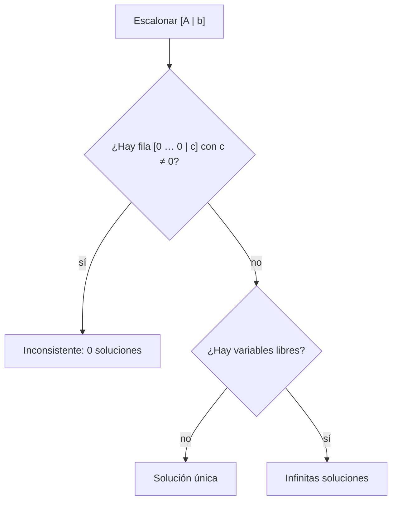

# Existencia y unicidad de soluciones

Una vez escalonada la matriz ampliada, dos preguntas se responden sin terminar de resolver: **¿existe solución?** y, si existe, **¿es única?** La respuesta depende solo de dónde caen los pivotes. Esta nota da el criterio y la forma de escribir todas las soluciones cuando hay infinitas.

## Variables básicas y libres

Sea $[A \mid \mathbf b]$ la ampliada de un sistema consistente, ya en FER.

> [!tip] Definición
> Las **variables básicas** son las que corresponden a columnas pivote de $A$. Las **variables libres** son las demás.

Las libres funcionan como **parámetros**: se les puede dar cualquier valor, y cada fila no nula de la FER despeja una variable básica en función de ellas. Por ejemplo,

$$
\left[\begin{array}{ccc|c} 1 & 0 & -5 & 1 \\ 0 & 1 & 1 & 4 \\ 0 & 0 & 0 & 0 \end{array}\right]
\quad\Longrightarrow\quad
\begin{cases} x_1 = 1 + 5x_3 \\ x_2 = 4 - x_3 \\ x_3 \text{ libre} \end{cases}
\quad\Longrightarrow\quad
\mathbf x = \begin{bmatrix}1\\4\\0\end{bmatrix} + x_3\begin{bmatrix}5\\-1\\1\end{bmatrix}.
$$

Geométricamente es una recta en $\mathbb{R}^3$: tres planos que comparten una recta (la tercera ecuación era redundante).

Con más columnas el método es el mismo. Si la ampliada se reduce a

$$
\left[\begin{array}{ccccc|c} 1 & 6 & 0 & 3 & 0 & 0 \\ 0 & 0 & 1 & -4 & 0 & 5 \\ 0 & 0 & 0 & 0 & 1 & 7 \end{array}\right],
$$

las básicas son $x_1, x_3, x_5$ y las libres $x_2, x_4$. La solución es $x_1 = -6x_2 - 3x_4$, $x_3 = 5 + 4x_4$, $x_5 = 7$:

$$
\mathbf x = \begin{bmatrix}0\\0\\5\\0\\7\end{bmatrix} + x_2\begin{bmatrix}-6\\1\\0\\0\\0\end{bmatrix} + x_4\begin{bmatrix}-3\\0\\4\\1\\0\end{bmatrix}.
$$

Esta **forma vectorial paramétrica** muestra que el conjunto solución es un plano (dos parámetros) dentro de $\mathbb{R}^5$.

## Criterio de existencia y unicidad

> [!tip] Teorema de existencia y unicidad
> Un sistema lineal es **consistente** si y solo si una forma escalonada de su matriz ampliada **no** tiene una fila del tipo
> $$[\,0 \ \cdots \ 0 \mid c\,], \qquad c \neq 0,$$
> es decir, si la última columna de la ampliada **no** es columna pivote. Si es consistente, tiene:
> - **solución única** si no hay variables libres (toda columna de $A$ es pivote);
> - **infinitas soluciones** si hay al menos una variable libre.

La fila prohibida dice $0x_1 + \dots + 0x_n = c$, es decir, $0 = c$, imposible. Si no aparece, la sustitución hacia atrás siempre encuentra valores.

**Ejemplo.** El sistema $\begin{cases} x_2 - 4x_3 = 8 \\ 2x_1 - 3x_2 + 2x_3 = 1 \\ 5x_1 - 8x_2 + 7x_3 = 1 \end{cases}$ se escalona a

$$
\left[\begin{array}{ccc|c} 2 & -3 & 2 & 1 \\ 0 & 1 & -4 & 8 \\ 0 & 0 & 0 & 5/2 \end{array}\right],
$$

y la última fila dice $0 = \tfrac52$: el sistema es **inconsistente**. Los tres planos no tienen punto común.

> [!warning] Un sistema con más incógnitas que ecuaciones no siempre tiene infinitas soluciones
> Si hay más incógnitas que ecuaciones, hay a lo más tantos pivotes como ecuaciones, así que **si es consistente**, sobran variables y hay infinitas soluciones. Pero puede ser inconsistente (dos planos paralelos distintos, por ejemplo). Lo que nunca puede tener es solución única.

## Sistemas con parámetros

Cuando los coeficientes dependen de un parámetro, se escalona dejándolo como letra y se separan casos **antes de dividir** por una expresión que puede ser cero.

**Ejemplo.** ¿Para qué $a$ el sistema $ax + y + z = 1$, $x + ay + z = 1$, $x + y + az = 1$, $x + y + z = a$ tiene solución única, ninguna o infinitas?

- **Caso $a = 1$.** Las tres primeras ecuaciones son $x + y + z = 1$ y la cuarta también. Infinitas soluciones: un plano.
- **Caso $a \neq 1$.** Restando las dos primeras ecuaciones, $(a - 1)(x - y) = 0$, así que $x = y$; del mismo modo $y = z$. Con $x = y = z$, la primera ecuación da $(a + 2)x = 1$ y la cuarta $3x = a$. Si $a = -2$, la primera es $0 = 1$: sin solución. Si no, $x = \tfrac{a}{3}$ y $(a + 2)\tfrac{a}{3} = 1$, o sea $a^2 + 2a - 3 = 0$, que da $a = 1$ (descartado) o $a = -3$.

Resumen: infinitas para $a = 1$, única para $a = -3$ (con $x = y = z = -1$) y ninguna para cualquier otro $a$.

## Preguntas de repaso

> [!question]- ¿Puede un sistema de 3 ecuaciones con 5 incógnitas tener solución única? ¿Y uno de 5 ecuaciones con 3 incógnitas?
> El primero no: tiene a lo más 3 pivotes para 5 variables, así que si es consistente quedan al menos 2 libres. El segundo sí puede (3 pivotes, uno por variable) si es consistente, aunque también puede ser inconsistente.

> [!question]- ¿Por qué la consistencia se decide mirando si la última columna de la ampliada es pivote?
> Porque un pivote en la última columna es exactamente una fila $[0 \cdots 0 \mid c]$ con $c \neq 0$, que representa la ecuación imposible $0 = c$.

> [!question]- Si un sistema consistente tiene matriz de coeficientes de $4 \times 6$ con 3 pivotes, ¿cuántos parámetros tiene su solución?
> $6 - 3 = 3$ variables libres, así que tres parámetros.

> [!question]- ¿Qué error se comete al dividir una fila por $(a - 1)$ sin separar casos?
> Para $a = 1$ esa operación sería multiplicar por $\tfrac10$, que no existe; y si se hubiera escalado por $(a - 1)$, sería multiplicar por $0$, que no es una operación elemental. El caso $a = 1$ se pierde y puede ser justo el que cambia el número de soluciones.
