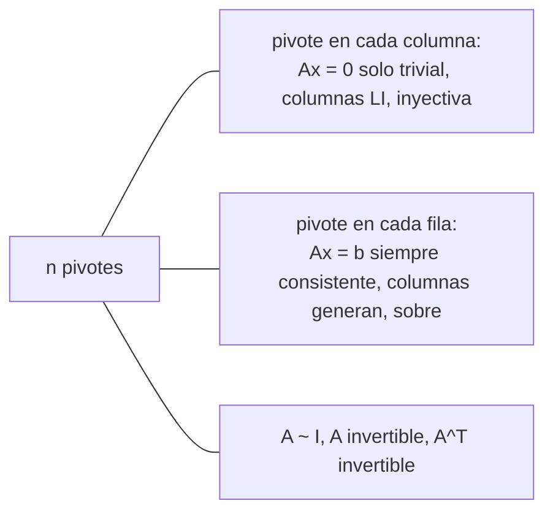

# Teorema de la matriz invertible

Para matrices **cuadradas**, casi todo lo visto en el curso dice lo mismo con distintas palabras: tener $n$ pivotes, columnas independientes, columnas que generan, sistemas siempre resolubles, transformación inyectiva, transformación sobre, ser invertible. El **teorema de la matriz invertible** reúne esas equivalencias. Su utilidad es práctica: basta verificar **una** condición (la más fácil en cada caso) para obtener todas las demás.

## El teorema

> [!tip] Teorema de la matriz invertible
> Sea $A$ una matriz **cuadrada** de $n \times n$. Las siguientes afirmaciones son equivalentes (todas verdaderas o todas falsas):
> 1. $A$ es invertible.
> 2. $A$ es equivalente por filas a $I_n$.
> 3. $A$ tiene $n$ posiciones pivote.
> 4. $A\mathbf x = \mathbf 0$ tiene solo la solución trivial.
> 5. Las columnas de $A$ son linealmente independientes.
> 6. $\mathbf x \mapsto A\mathbf x$ es inyectiva.
> 7. $A\mathbf x = \mathbf b$ tiene al menos una solución para todo $\mathbf b \in \mathbb{R}^n$.
> 8. Las columnas de $A$ generan $\mathbb{R}^n$.
> 9. $\mathbf x \mapsto A\mathbf x$ es sobre $\mathbb{R}^n$.
> 10. Existe $C$ de $n \times n$ con $CA = I$.
> 11. Existe $D$ de $n \times n$ con $AD = I$.
> 12. $A^T$ es invertible.

El eje de la demostración es la condición 3. En una matriz **cuadrada**, $n$ pivotes significa a la vez **un pivote por columna** (condiciones 4, 5 y 6: unicidad) y **un pivote por fila** (condiciones 7, 8 y 9: existencia). En una matriz rectangular esas dos cosas están desacopladas; en una cuadrada, una arrastra a la otra.

Las condiciones 10 y 11 dicen algo sorprendente: para matrices cuadradas basta una inversa **de un lado** para que sea inversa de ambos. Si $CA = I$, entonces $A\mathbf x = \mathbf 0$ implica $\mathbf x = CA\mathbf x = \mathbf 0$ (condición 4), y el teorema da el resto.

> [!warning] Solo para matrices cuadradas
> Para $A$ de $3 \times 5$, "las columnas generan $\mathbb{R}^3$" puede ser cierto sin que las columnas sean LI, y no hay inversa. Antes de usar el teorema hay que verificar que la matriz sea de $n \times n$.

## Cómo se usa

**Decidir invertibilidad escalonando.** $A = \begin{bmatrix} 1 & 0 & -2 \\ 3 & 1 & -2 \\ -5 & -1 & 9 \end{bmatrix}$ se reduce a una forma escalonada con tres pivotes, así que es invertible, sus columnas son LI y generan $\mathbb{R}^3$, todo a la vez. No hace falta calcular $A^{-1}$.

**Pasar de un sistema a todos.** Si $A$ es de $3 \times 3$ y $A\mathbf x = \langle 1, -2, 1\rangle$ tiene solución **única**, no hay variables libres, así que hay 3 pivotes y $A$ es invertible: todo $A\mathbf x = \mathbf b$ tiene solución única.

**Demostraciones con productos.** Si $A$ y $B$ son cuadradas y $AB$ es invertible, entonces $A$ es invertible: con $W = (AB)^{-1}$, se tiene $A(BW) = I$, que es la condición 11 para $A$. Del mismo modo, $(WA)B = I$ muestra que $B$ es invertible.

## Transformaciones invertibles

> [!tip] Definición y teorema
> $T: \mathbb{R}^n \to \mathbb{R}^n$ es **invertible** si existe $S: \mathbb{R}^n \to \mathbb{R}^n$ con $S(T(\mathbf x)) = \mathbf x$ y $T(S(\mathbf x)) = \mathbf x$ para todo $\mathbf x$. Si $T$ es lineal con matriz estándar $A$, $T$ es invertible si y solo si $A$ es invertible, y entonces $T^{-1}(\mathbf x) = A^{-1}\mathbf x$.

Para una transformación lineal de $\mathbb{R}^n$ en sí mismo, "inyectiva", "sobre" e "invertible" son lo mismo. Las rotaciones y reflexiones son invertibles; las proyecciones no.

## Preguntas de repaso

> [!question]- Una matriz de $4 \times 4$ tiene dos columnas iguales. ¿Es invertible?
> No. Las columnas son LD (la diferencia de esas dos columnas da una relación no trivial), lo que viola la condición 5.

> [!question]- Si $T: \mathbb{R}^n \to \mathbb{R}^n$ es lineal e inyectiva, ¿qué más se puede decir?
> Que es sobre, invertible, y que su matriz estándar es invertible: en una matriz cuadrada, un pivote por columna implica uno por fila.

> [!question]- Demuestre que si $AB^T$ es invertible ($A$, $B$ de $n \times n$), entonces $B$ es invertible.
> Sea $W = (AB^T)^{-1}$. Entonces $(WA)B^T = I$, así que $B^T$ tiene inversa por la izquierda y es invertible por el teorema; luego $B = (B^T)^T$ también lo es (condición 12).

> [!question]- V o F: si $A$ es de $3 \times 3$ y $A\mathbf x = \mathbf b$ tiene solución para algún $\mathbf b$, $A$ es invertible.
> Falso. Tener solución para **un** $\mathbf b$ no basta: con $A = 0$ y $\mathbf b = \mathbf 0$ hay solución, pero $A$ no es invertible. Se necesita solución para **todo** $\mathbf b$ o unicidad.

> [!question]- Si $A^2$ es invertible, ¿lo es $A$?
> Sí. Con $W = (A^2)^{-1}$, $A(AW) = I$, así que $A$ tiene inversa por la derecha y, siendo cuadrada, es invertible.
